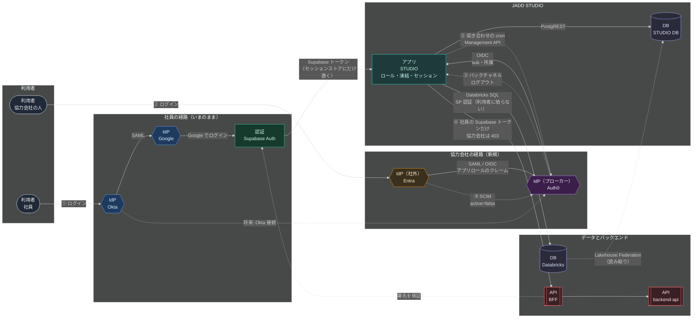

# IdP の役割分担の検討（Okta / Google Workspace / Auth0）

- 開始: 2026-10-14
- 状態: **調査と、構想との適合性の確認の段階**。協力会社の相手先はまだ無い。実施の段取りはこの資料の範囲外
- 所属: project:idp-broker（2026-10-26 に `~/docs/workstream/` から移した）
- 関連: [M2M 認証の手法の確立](../../m2m-auth/workstream/m2m-auth.md)（退職の同期・ロールの持ち場・BFF 撤廃後の backend-api の入口が共通の論点）

## 背景

- 社員の認証基盤は **Okta**。SmartHR を正本に、入社・退職・属性変更を Okta Terraform の PR で反映している（`/usr/app/identity`）。
- **Google Workspace** は Okta から SAML で SSO される「中間の認証基盤」。社内アプリの多くは「Google でログイン」で認証している
  （identity リポの Service List で Auth=Google のもの: Databricks / Slack / Akerun / Devin / JADD STUDIO 3 / 運行スケジュール / 座席表）。
- これらのアプリを、**アクセス制御を施したうえで協力会社の人にも使わせたい**。
- 協力会社はおおむね大企業で、**自社の IdP（Entra ID / Okta 等）が整っている**。
- そこへ **Auth0** を入れることを考えているが、3 つの役割分担が決まらない。
- **ブローカーの製品は Auth0 に決めていない（変数）。** 以下で「Auth0」と書く箇所は「ブローカー」と読み替えられる。Auth0 以外の候補は「[ブローカーの候補](#ブローカーの候補auth0-以外も含めて)」で比べる。

### 前提（2026-10-14 に確定）

- 協力会社は**非常に大きな会社**で、IdP は **Entra ID の可能性が高い**。
  - **2026-10-16 に改めた: IdP は製品名で決め打ちしない。** ブローカーの要件は「大手が使う IdP（Entra ID・Okta・Ping Identity・ForgeRock・HENNGE One など）を SAML / OIDC で受け、SCIM を受けられること」とする。Entra ID は外から見える情報で最有力というだけ（下の「協力会社の IdP について外から確かめられること」）。
- アクセスが要るのは、その中の**ごく一部の部門・人員だけ**。
- 対象アプリは**まず JADD STUDIO だけ**。他のアプリへの展開はいったんスコープ外。
  - **2026-10-16 に広げた:** backend-api も、機能をかなり絞ったうえで協力会社に使ってもらう可能性がある。jadd-cli は backend-api の認証が解ければ一緒に解ける想定（「backend-api と jadd-cli の認証」の前提）。
- **Auth0 の費用はあまり気にしない。** 運用の負荷・変更のしやすさ・設計の綺麗さを優先する。
- **STUDIO の中でできること（ロール）は STUDIO で管理する。**
- STUDIO は利用者が**どの組織の人かを属性として記録・管理する**が、**それで権限を変えることはしない**。STUDIO の中では全員フラットで、そこから適切なロールを付ける運用にする。
- 協力会社の入場の絞り方は**案 2 を基に進める**（下の「協力会社をどこで絞るか」）。**guest が自動で作られることは許容する。**
- **退職者・離任者の処理は必須。** できるだけリアルタイムに連携したいので **SCIM で受ける**。必要なら定期実行のバッチも併用する。

### 協力会社の IdP について外から確かめられること（2026-10-16）

第一候補のデンソーとトヨタについて、公開の情報だけで調べた。使ったのは DNS の公開レコードと、Microsoft のログイン画面が使う公開のエンドポイント（`getuserrealm.srf`：そのドメインが Entra ID で認証されるか、外部の IdP へフェデレーションしているかを返す）、公開の事例。

| ドメイン | 会社 | Entra ID のテナント | 認証の形 | ほかに見えたもの |
|---|---|---|---|---|
| `jp.denso.com` | デンソー（日本） | あり（ブランド名 `DENSO`） | **Managed**（Entra ID が自分で認証。ADFS・Okta などへのフェデレーションではない） | MX が Microsoft 365（`mail.protection.outlook.com`）。Atlassian・Notion・Box・Miro・Docusign 等のドメイン確認 |
| `denso.com` / `globaldenso.com` | デンソー（グループ・対外向け） | なし | — | MX は国内のメールゲートウェイ |
| `mail.toyota.co.jp` | トヨタ自動車（社員のメールのドメイン） | あり | **Managed** | — |
| `toyota.co.jp` | トヨタ自動車（対外向け） | なし | — | MX は FortiMail |
| `toyota.com` | Toyota Motor North America | あり（ブランド名 `TMNA`） | **Managed** | MX は Proofpoint。Atlassian・Notion・Docusign 等のドメイン確認 |

読み取れること:

- **デンソーとトヨタは、社員のメールのドメインを Entra ID のテナントで、フェデレーションせずに認証している。** Microsoft 365 へのサインインの IdP は Entra ID そのもの。こちら向けのアプリも Entra ID で作ってもらう形が最も自然。
- ただし次の点は外からは分からない。**相手先の IT に確かめる。**
  - 社外のアプリとのフェデレーションを Entra ID で出すか、別の IdP（例: トヨタはグループ共通の ID を別に持ち、欧州法人は Ping Identity / ForgeRock で取引先向けポータルを運用している）で出すか
  - 協力会社の中の**どの会社・どのテナント**の人が使うか（グループ会社・地域法人はテナントが別。トヨタ本体と TMNA でも別テナント）
  - SCIM のプロビジョニングと条件付きアクセスを、こちら向けのアプリに設定してもらえるか
- 公開の事例・報道では、デンソー・トヨタの社員向けの IdP を明言したものは見つからなかった（見つかったのはトヨタの顧客向けの共通 ID と、欧州法人の取引先向けポータルの事例だけ）。

### いまの協力会社の扱い（参考）

- JADD STUDIO は、Google アカウントを使わない相手向けに**独自のメール+パスワード+2 段階認証**を持っている（`docs/general/authentication.md`）。
  外部の相手に Supabase アカウントを渡すと BFF を直接叩けてしまうため、あえて Supabase を通さない作りになっている。
- Google Workspace には `/Workspace Guests` の OU がある。
- どちらも「協力会社の IdP での本人確認・退職での停止」には乗っていない。

## 問題の核

**いまアプリが信頼している相手は Google だが、Google は協力会社の IdP を受け入れられない。**

- 「Google でログイン」で入れるのは Google アカウントを持つ人だけ。協力会社の Entra ID などを Google の上流に繋ぐことはできない
  （Google Workspace の SSO は自社ドメインの利用者向け。GCP の Workforce Identity Federation は GCP コンソール/API 用で、第三者アプリの「Google でログイン」には効かない）。
- だから協力会社を入れるには、どこかに **「複数の IdP を受け入れて、アプリにトークンを出す層（ブローカー）」** が要る。
  候補は Okta（Workforce）か Auth0 のどちらか。Google はこの役を担えない。

決めるべきことは結局この 2 つ:

1. **ブローカーをどれにするか**（Okta Workforce か Auth0 か）
2. **「誰がどのアプリを使えるか」（認可）をどこに持つか**

> **2026-10-16 に改めた**: ブローカーの候補は Auth0 以外にも広げて比べ、Okta Workforce（案 B）は外した（「ブローカーの候補」「決まったこと」）。上の「Okta（Workforce）か Auth0」は 10-14 に書いた当時のもの。

## 選択肢

| | A. Google にアカウントを作る | B. Okta Workforce に取り込む | C. Auth0 をアプリの入口にする |
|---|---|---|---|
| やり方 | 協力会社の人に Google アカウント（ゲスト / Cloud Identity）を発行 | Okta に協力会社 IdP を外部 IdP として登録（Inbound Federation）。Secure Partner Access で会社ごとに管理を委譲 | アプリは Auth0 に繋ぐ。社員は Okta、協力会社は各社 IdP を Auth0 の接続として登録し、会社ごとに Organization を切る |
| 協力会社の IdP で本人確認 | ✗（別のパスワードが増える） | ○ | ○ |
| 相手先での退職が効く | ✗（こちらが知るまで残る） | ○（新規ログインは止まる） | ○（新規ログインは止まる） |
| 社員の台帳と混ざるか | 混ざる | **混ざる**（同じ Universal Directory。Realm で分けられる） | 混ざらない（Okta は社員だけのまま） |
| アプリの改修 | 不要 | Okta の OIDC へ繋ぎ替え | Auth0 の OIDC へ繋ぎ替え |
| 費用の目安 | Workspace のライセンス | 1 人あたり課金（Essentials $17/人/月）+ Secure Partner Access は別売（営業見積） | B2B Essentials $150/月（500 MAU・企業接続 3 本）、接続の追加 $100/月/本（上限 30）。Okta 接続は本数無制限 |
| 運用の分かれ方 | Google 側 | Okta の上で一元 | Okta（社員）と Auth0（アプリ・社外）の 2 枚 |

> 料金は 2026-10-14 時点の公開ページ（[Auth0 Pricing](https://auth0.com/pricing)・[Okta Pricing](https://www.okta.com/pricing/)）。Okta の料金表では Inbound Federation が Workforce の各スイートに載っておらず（Customer Identity 側の機能として載っている）、Secure Partner Access も見積制なので、**B の可否と値段は Okta の営業に確認が要る**。

### A は採らない

協力会社の IdP を使えず、退職が効かず、こちらにパスワード管理の責任が残る。いまの JADD STUDIO のメール認証と同じ問題を全アプリに広げることになる。

### B と C の分かれ目

- **B（Okta 一本）**: 道具が増えない。ただし協力会社の人が社員と同じ台帳に入り、SmartHR → Terraform のライフサイクルの外にいる人を Okta に抱えることになる。
  人数に比例して課金されるので、協力会社の人数が多いほど高い。
- **C（Auth0 を足す）**: Okta は「社員の正本」のまま触らずに済む。社外の人は会社単位（Organization）で受け入れ、費用は主に「月に使った人数」と「協力会社の数」で決まる。
  代わりに管理する面が 1 枚増える。

## 推奨案: C（Auth0 を社内アプリ共通の入口にする）

### 役割分担

| 基盤 | 役割 | 持たない役割 |
|---|---|---|
| **Okta** | **社員（と社員扱いの業務委託）の正本**。本人確認・MFA・入退社。Auth0 から見ると「上流の IdP の 1 つ」 | 協力会社の人のアカウント |
| **Google Workspace** | **Google のサービス（Gmail / Drive / GCP）を使うための SP**。これまでどおり Okta から SAML で入る | **自社アプリの認証（ブローカー）役は段階的に Auth0 へ移す** |
| **Auth0** | **自社アプリの共通の入口**。社員は Okta 接続、協力会社は各社 IdP の接続で受け入れる。相手先の IdP が「このアプリに入れてよい」と割り当てた証拠を確かめてからトークンを出し、所属（Organization）を属性として渡す | 社員の台帳・ライフサイクル（Okta が正本）・アプリの中のロール（アプリが正本） |
| **協力会社の IdP** | 自社社員の本人確認・MFA・退職時の停止（**契約で責任を明記**） | こちらのアプリの権限 |

```
社員        ── Okta ──(SAML)── Google Workspace … Gmail / Drive / GCP
              │
              └─(OIDC: Okta 接続)──┐
                                    ├─ Auth0 ──(OIDC)── 社内アプリ（JADD STUDIO / Fleet Ops / …）
協力会社 X ── X社の IdP ─(SAML/OIDC)─┤   Organization「X社」（所属の属性）
協力会社 Y ── Y社の IdP ─(SAML/OIDC)─┘   Organization「Y社」（所属の属性）
```

社員は Google を経由させず **Okta から直接 Auth0 へ** 入れる。Google を挟むと「Okta → Google → Auth0」と信頼の鎖が 1 段長くなり、Google 側の停止・遅延も効いてしまうため。

### なぜ C か

1. **Okta を社員の正本のまま保てる。** identity リポの運用（SmartHR を正本に Terraform の PR で反映・merge は人間）を協力会社の分で崩さない。
2. **協力会社は「会社単位」で扱うのが自然。** 大企業相手は「X社の誰をどのアプリに」という契約単位で決まる。Auth0 の Organization がそのまま対応する。
3. **協力会社の追加がアプリの改修にならない。** 接続と Organization を Auth0 に足すだけで済む（費用は優先度が低いが、人数でなく MAU と接続本数で決まる）。
4. **Auth0 は Okta 社の製品**で、Okta との接続は本数無制限（料金表）。調達・サポートの窓口が揃う。

### C を選んでも決めておくべきこと（設計上の要点）

1. **協力会社の IdP の「全社員」が入れてしまわないようにする。**
   接続を繋いだだけだと、X社の IdP にいる全員がログインできる。どこで絞るかは下の「[協力会社をどこで絞るか](#協力会社をどこで絞るか)」で議論する。
2. **「入れるか」と「何ができるか」を分ける。**
   - 「そのアプリの利用者になれるか」（入場）: 各組織の IdP が決め、Auth0 がその証拠を確かめる。
   - 「アプリの中で何ができるか」: アプリが決める（JADD STUDIO ならロールと `TripAccessPolicy`）。Auth0 にロールを持たせない。
3. **退職時の止まり方。**
   相手先で停止されると新規ログインは止まるが、**こちらのアプリの既存セッションは残る**。JADD STUDIO は「7 日放置で失効・使い続ければ無期限」なので、Auth0 の受信側 SCIM で停止を受け取り、STUDIO まで伝える（下の「退職・離任したら止まるまで」）。
4. **利用者の識別子。**
   メールアドレスは接続をまたいで衝突・変更されうる。アプリ側の利用者は Auth0 の `sub`（接続ごとの安定 ID）で照合する。
5. **JADD STUDIO の BFF との関係。**
   STUDIO の BFF は Supabase のトークンを「署名・期限・aud・email」だけで通すため、外部の相手に Supabase のトークンを渡してはいけない（`docs/general/authentication.md`）。
   Auth0 を入れても **協力会社の人には Supabase のトークンを出さない**。STUDIO のセッションは Auth0 の ID トークンから直接作り、BFF が Auth0 のトークンを受けるなら audience を分けて協力会社のトークンが通らないようにする。
   （Supabase の Third-Party Auth は Auth0 に対応しているが、それを使うと上の性質が崩れるので、社員用と社外用で分けて考える）
6. **IaC の lane。**
   Auth0 は Terraform provider（`auth0/auth0`）があるので、identity リポの IaC lane に載せられる。協力会社の接続・Organization・ロールの割当を PR で管理する。

## 構想: JADD STUDIO に協力会社（Entra ID）を入れる

### 全体図

> **2026-10-16 に改めた**: 社員も、ブローカーの導入が決まれば Okta からブローカー経由に置き換える。Supabase のトークンはどの段でも扱わない（「決まったこと」）。この図の「社員の経路（いまのまま）」と ① は、協力会社だけを通す前提で書いた当時のもの。

| エイリアス | 実体 | 種類 |
|---|---|---|
| 社員 | 自社の社員（と社員扱いの業務委託） | 利用者 |
| 協力会社の人 | 協力会社のうち、案件の部門の人 | 利用者 |
| Okta | Okta Workforce（社員の正本。SmartHR → Terraform） | IdP |
| Google | Google Workspace（Okta から SAML で SSO） | IdP |
| Entra | 協力会社の Entra ID（「割り当てが必要」+ 部門のグループ + アプリロール） | IdP（社外） |
| Auth0 | Auth0（B2B・Enterprise）。協力会社ごとに企業接続と Organization | IdP（ブローカー） |
| Supabase Auth | Supabase Auth（Google ログインを受け、backend 用のトークンを出す） | 認証 |
| STUDIO | JADD STUDIO（Next.js。セッション・ロール・凍結を持つ） | アプリ |
| STUDIO DB | Supabase の Postgres（jadd_studio DB。user・ロール・所属・セッションストア） | DB |
| Databricks | Databricks SQL ウェアハウス（走行データ・評価結果） | DB |
| BFF | `api.turing-ai.dev` の BFF（Supabase トークンの署名・期限・aud・email だけを確かめる） | API |
| backend-api | mono-e2e の FastAPI（`/v1/...`） | API |



| 番号 | 流れ | 要点 |
|---|---|---|
| ① | 社員のログイン | いまのまま。Okta → Google → Supabase Auth。STUDIO は Supabase のトークンをセッションストアにだけ置き、backend を呼ぶときに使う |
| ② | 協力会社のログイン | Entra が割り当てた人にだけアプリロールのクレームを載せ、Auth0 の Action が無い人を拒否する（入場）。STUDIO は初回に guest で作り、所属を属性として記録する。何をできるかは STUDIO のロールで決める |
| ③ | 協力会社の離任 | 相手先で外す → Entra が SCIM で無効化 → Auth0 が blocked にしてバックチャネルログアウト → STUDIO がセッションを失効し、Auth0 の状態を見て凍結。取りこぼしは突き合わせの cron で拾う |
| ④ | backend の遮断 | 協力会社の人には Supabase のトークンが無いので、能力 `backendAccess` が false になり BFF に届かない。BFF はロールを見ないので、**協力会社に Supabase のトークンを持たせないことが遮断の要** |

- Databricks は STUDIO のサーバーが SP の資格情報で読む。利用者が誰かに依らないので、**協力会社に見せる範囲は STUDIO のロール（と `TripAccessPolicy`）だけで決まる**。
- Supabase は 2 つの役で出てくる。社員の認証（Supabase Auth）と、STUDIO の DB（Postgres）。協力会社が関わるのは DB の行（user・セッション）だけで、Supabase Auth には一切現れない。
- 破線の「将来: Okta 接続」は、社員も Auth0 から入れるようにする場合の経路。この構想の範囲外。

> **2026-10-16 に改めた**: 上の「将来: Okta 接続」は、ブローカーの導入が決まれば社員の経路になる（「決まったこと」）。④ の「協力会社は backend に届かない」も改めた。協力会社には backend-api も機能を絞って使ってもらう可能性があり、誰に許すかは backend-api の `user_role` に協力会社の行を `(iss, sub)` で持って判定する（「backend-api と jadd-cli の認証」）。BFF は撤廃に向かっている（「backend-api の課題と、今の動き」）。


### 1 アプリ・1 社なら Auth0 は必須ではない

STUDIO が協力会社の Entra ID に**直接** OIDC/SAML でつなぐこともできる。比べると次のとおり。

| | STUDIO が Entra に直接つなぐ | STUDIO → Auth0 → Entra |
|---|---|---|
| 費用 | 0 | Enterprise プラン（見積制）。SCIM とバックチャネルログアウトのため（下の「退職・離任したら止まるまで」） |
| STUDIO の実装 | 相手先ごとの接続設定・鍵の更新・SAML/OIDC の差を STUDIO が持つ | **Auth0 との OIDC 1 本だけ**。協力会社が増えても STUDIO は変わらない |
| 協力会社の追加 | STUDIO の改修・設定 | Auth0 の設定（Terraform）で済む |
| 他アプリへの展開 | アプリごとに同じ実装を繰り返す | 同じ接続を使い回せる |
| 離任の受け取り（SCIM） | **STUDIO が SCIM サーバーを実装する** | Auth0 が受ける。STUDIO はバックチャネルログアウトを受けるだけ |

**推奨は Auth0 経由。** 費用より運用と変更のしやすさを優先するという前提なら、なおさらこちら。STUDIO は「Auth0 を信頼する」1 本だけを持ち、相手先ごとの差（SAML/OIDC・証明書・入場の確かめ方）は Auth0 の設定に閉じ込められる。2 社目・2 つ目のアプリが来ても STUDIO を作り直さなくてよい。

### 社員はいまのまま（Google）

> **2026-10-16 に改めた**: 社員も、ブローカーの導入が決まれば Okta からブローカー経由に置き換える。Supabase のトークンはどの段でも扱わない（「決まったこと」）。この節は協力会社だけを通す前提で書いた当時のもの。

この構想では社員のログインは触らない。Auth0 を通るのは協力会社だけにする。

- 社員の動線を変えないので、パイロットの失敗が社員に波及しない。
- 社員は Supabase のトークン（BFF を叩ける資格情報）が要る。Auth0 経由にすると Supabase の発行をどうするかの検討が増えるので、後回しにする。
- Auth0 の MAU は協力会社の人数だけになる。

### 協力会社をどこで絞るか

> 2026-10-14 の初版では「相手先の割り当て + STUDIO の事前登録」の 2 段を推していた。
> STUDIO を「全員フラット・所属で権限を変えない」と決めたので、**STUDIO の事前登録はやめ、こちら側の確かめは Auth0 に置く**案に改めた。理由は以下。

#### 分けて考える: 「入場」と「権限」

協力会社の人を絞る話には、2 つの別の問いが混ざっている。

| 問い | 例 | どこで決めるか |
|---|---|---|
| **入場**: この人は STUDIO の利用者になりうるか | X社 10 万人のうち、案件の部門の 30 人だけ | **ここを議論する** |
| **権限**: 利用者になった人が STUDIO で何をできるか | 30 人のうち 5 人に `external_viewer` | **STUDIO のロール（決定済み）** |

STUDIO では、ロールの無い利用者（guest）は全ページ・全 API で拒否される。だから **「この人に使わせるか」という 1 人ずつの判断は、STUDIO でロールを付ける時点ですでにこちらが握っている**。
入場の段で絞るべきなのは「1 人ずつの承認」ではなく、**「STUDIO の利用者一覧に現れうる母集団」を案件の関係者に限ること**だけになる。

#### 絞れる場所

| | 場所 | 何で絞るか | 誰が持つ台帳か |
|---|---|---|---|
| L1 | 協力会社の Entra ID | こちら向けアプリの「割り当てが必要」+ 対象部門のグループの割り当て | 相手先の IT |
| L2 | Auth0 | ログインの途中（Action）で、トークンの中身を見て通すか決める | こちら（設定は Terraform） |
| L3 | STUDIO のログイン | 事前に登録した人だけ通す | こちら（`/users`） |
| L4 | STUDIO のロール | guest のままなら何もできない | こちら（`/users`）※決定済み |

#### 案の比較

| 案 | 入場の絞り方 | 運用の負荷 | 変更のしやすさ | 設計の綺麗さ |
|---|---|---|---|---|
| **1. 相手先に任せる** | L1 だけ。こちらは確かめない | ◎ 何もしない | ◎ | △ 相手先が「割り当てが必要」を外すと、**全社員が入れることにこちらは気づけない** |
| **2. 相手先が決め、Auth0 が証拠を確かめる（推奨）** | L1 で割り当て、**割り当てた人にだけアプリロールのクレーム（例: `JADDStudio.User`）が載る**ようにしてもらう。L2 の Action で、そのクレームが無いトークンは拒否する | ◎ 1 人ずつの台帳を持たない。人の出入りは相手先のグループだけで済む | ◎ 確かめ方の変更は Auth0 の設定だけ。STUDIO は変わらない | ◎ 入場は IdP 側、権限は STUDIO と、境界がそのまま責任の境界になる |
| 3. Auth0 に個人の許可リスト | L1 + L2 で、許可した人の一覧と照合 | × 一覧を相手先の異動と手で合わせ続ける | ○ | △ 相手先の台帳の写しをこちらが持つ |
| 4. STUDIO で事前登録（初版の案） | L1 + L3 | × 3 と同じ写しを STUDIO が持つ | △ 協力会社ごとの入場の規則が STUDIO に入る | × **「全員フラット」なはずの STUDIO が、ログインの段で所属による扱いを持つ** |

#### 推奨: 案 2

- **入場は「その人の所属組織の IdP」が決める。** 社員は Okta（と Google）が、協力会社は相手先の Entra が「この人は STUDIO の利用者候補だ」と決める。STUDIO はどちらも同じく「Auth0（と Google）から来た人は利用者」と扱い、**所属を見ない**。STUDIO の「全員フラット」の決定とそのまま揃う。
- **こちらは「相手先がちゃんと割り当てたこと」だけを確かめる。** 「割り当てが必要」の設定そのものはこちらから見えないが、アプリロールのクレームは割り当てを通った人にしか載らない。だから Auth0 でクレームの有無を見れば、相手先の設定ミスがあっても拒否する側に倒れる。
- **こちらの 1 人ずつの判断は L4（ロールの付与）に一本化する。** 入場した人は STUDIO に guest としてでき、管理者がロールを付けて初めて使える。社員が Google で初めて入ったときと同じ流れ。
- 相手先の負担は、割り当てのついでにアプリロールを 1 つ定義することだけ。

```
X社の Entra ID           Auth0                        JADD STUDIO
─────────────           ─────                        ───────────
部門のグループを          トークンに
アプリに割り当て   ──▶    JADDStudio.User が    ──▶   初回は guest で作る（所属 = X社 を記録）
（ロール JADDStudio.User）  無ければ拒否                管理者がロールを付ける
                          所属（Organization）を付ける
```

#### 案 2 で決めておくこと

- **guest が自動でできることを許容するか。** 入場が案件の部門に絞られていれば、一覧に現れるのはその部門の人だけ。社員の Google ログインと同じ扱いなので許容できる見込み。
- **異動・退職で外れた人の扱い。** L1 で外されると次のログインから入れない。STUDIO に残ったアカウントとロールは、下の「退職・離任したら止まるまで」で止める。
- **相手先での申請の流れ。** 誰が相手先の IT にグループへの追加を頼むか（相手先の案件責任者を窓口にする等）。こちらは関与しない形が一番軽い。
- **案 3 が要るとき。** 契約上「こちらが 1 人ずつ承認するまで、アカウントすら作らせない」ことが求められる場合だけ。そのときも STUDIO（案 4）でなく Auth0 に置く。

### STUDIO 側はいまの仕組みにそのまま乗る

STUDIO にはすでに外部の人を受け入れる仕組みがある（`docs/general/authentication.md`）。新しい「協力会社 SSO」の経路は、メールユーザーとほぼ同じ扱いにできる。

- **認可は STUDIO のロールのまま。** `external_viewer` などのベースロールと追加ロールで、何を見られるかを決める。Auth0 にはロールを持たせない（二重管理しない）。
- **BFF には届かない。** 協力会社の人に Supabase のトークンは出さないので、能力 `backendAccess` が自動で false になり、`requireBackendToken` で backend 依存の API は 403 になる。BFF の改修は要らない。
  - **2026-10-16 に改めた:** 協力会社にも backend-api を機能を絞って使ってもらう可能性があり、誰に許すかは backend-api の `user_role` で判定する。BFF は撤廃に向かっている（「backend-api と jadd-cli の認証」「backend-api の課題と、今の動き」）。この項は協力会社を backend に通さない前提で書いた当時のもの。
- **セッションの形は同じ。** `authMethod` に新しい値（例: `sso`）を足すだけで、`proxy.ts` の検証は分岐しない。
- **2 段階認証は相手先に任せる。** メールユーザーの TOTP は要らなくなる。相手先の条件付きアクセスで MFA を必須にしてもらい、こちらは ID トークンの `amr`（認証方法）を見て確かめることもできる。

### 本人の照合はメールアドレスでなく ID で

- Entra の `email` クレームは、テナントの管理者が書き換えられる属性で、**メールアドレスの所有を証明しない**（Entra でメールを信頼してアカウントが乗っ取られる「nOAuth」と呼ばれる問題）。
- STUDIO の「メールユーザーの Google 引き取り」は、Google がアドレスの所有を証明するから成り立っている。**Entra 経由のログインでは同じ引き取りをしない。**
- 利用者は **テナント ID（`tid`）+ オブジェクト ID（`oid`）**（Auth0 なら `sub`）で照合する。同じメールアドレスの既存ユーザーがいても結び付けず、別の利用者として作る。
- 所属（Organization）は Auth0 がトークンに載せたものを属性として記録する。利用者が入力した値やメールのドメインからは決めない。

### 退職・離任したら止まるまで（SCIM + 突き合わせの cron）

**方針: 相手先の Entra から Auth0 へ SCIM で停止を受け取り、Auth0 が STUDIO へバックチャネルログアウトで知らせる。取りこぼしは定期の突き合わせで拾う。**
社員の「Google で止められた人を凍結する」（`/api/auth/offboarding-sync`）と同じ形を、協力会社の分は Auth0 を正にして作る。

#### リアルタイム側の流れ

```
相手先の IT            Entra ID                 Auth0                         JADD STUDIO
───────────          ────────                 ─────                         ───────────
グループから外す  ─▶   プロビジョニング    ─▶   ユーザーを blocked にする  ─▶  バックチャネルログアウトを受ける
／退職で無効化        （約 40 分ごと）          Auth0 のセッションを終了         ① その人のセッションを失効
／削除               SCIM PATCH active=false   RT を失効                       ② Auth0 に状態を聞き、
                                                バックチャネルログアウトを送る       blocked / 削除なら凍結
```

| 段 | 何が起きるか | かかる時間 |
|---|---|---|
| Entra → Auth0 | Entra のプロビジョニングの増分サイクルで `active=false` の PATCH が届く。急ぐときは相手先が「オンデマンドでプロビジョニング」を押せば即時 | **約 40 分ごと**（サイクルの間隔は変えられない） |
| Auth0 | SCIM で無効化を受けると、その人を blocked にし、Auth0 のセッションを終え、RT を失効させ、設定があれば OIDC バックチャネルログアウトを送る（Auth0 の文書に明記） | 即時 |
| Auth0 → STUDIO | STUDIO の受け口がログアウトトークンを検証し、その人のセッションを失効させる。続けて Auth0 の Management API でその人が blocked / 削除なのを確かめて凍結する | 即時 |

- **バックチャネルログアウトは通常のログアウトでも届く。** だから「届いたら凍結」にはしない。届いたらセッションを失効させ、**凍結するかは Auth0 のユーザーの状態を見て決める**。
- 受け口は cron と同じく利用者のセッションを持たない。**ログアウトトークンの署名（`iss`・`aud`・`events`）だけが入口の検証**になる。`defineRoute` でどう宣言するかは実装時に決める。
- 凍結は既存の `UserFreeze` に乗せる。凍結と同じトランザクションでセッションを失効させる既存の仕様がそのまま効く。
- **相手先で戻された（`active=true`）ときは、Auth0 は解除されるが STUDIO は凍結のまま。** 管理者が手で再開する。社員の凍結と同じ扱い。

#### 定期の突き合わせ（cron）

リアルタイム側は「届けば速い」が、受け口の障害・デプロイ中・Auth0 側の送信失敗で取りこぼしうる。**取りこぼしを拾う cron を必ず置く。**

- STUDIO の協力会社 SSO の利用者ごとに、Auth0 のユーザーを `sub`（Auth0 の `user_id`）で引き、**blocked か存在しなければ凍結する**。メールアドレスは使わない。
- Auth0 を読めなければ何もしない（`offboarding-sync` と同じく、読めないことを「全員止まった」と取り違えない）。
- 頻度は 1 時間ごと程度。リアルタイム側が正常なら cron は何も見つけない。何かを凍結したら、リアルタイム側が取りこぼした印として警告を出す。

#### SCIM そのものが止まったとき

相手先のプロビジョニングが止まる（認証トークンの期限切れ・相手先での隔離など）と、**停止が一切届かなくなるのに、こちらからは静かに見える。**

- その間も、相手先で無効にされた人の**新しいログインは Entra が断る**。残るのは STUDIO の既存のセッションだけ。
- その残りを抑えるため、協力会社 SSO のセッションには**絶対的な寿命**を付ける（例: 7 日）。SCIM が正常なら効く場面は無い保険。
- SCIM のトークンの期限はこちらで台帳に載せ、相手先と更新の段取りを決めておく。プロビジョニングの状態は相手先にしか見えないので、異常時に知らせてもらう取り決めも要る。

#### 入場との関係

- 相手先には SCIM の範囲を「割り当てられたユーザーとグループだけ」にしてもらう。**入場（案 2 の割り当て）と SCIM の範囲が同じグループになる**ので、外せば入場も同期も同時に止まる。
- SCIM で作られたユーザーと SSO でログインしたユーザーが **Auth0 で同じ 1 人になるように**、SCIM の `userName` と SSO 側の識別子（SAML の NameID / OIDC の `oid`）を揃える。揃わないと同じ人が 2 人でき、停止が届かない側のユーザーが残る。**検証環境で最初に確かめる。**

#### Auth0 のプランとの関係

- 受信側 SCIM はすべてのプランに含まれる。**OIDC バックチャネルログアウトは Enterprise プランだけ**。
- Enterprise 以外のプランでは、バックチャネルログアウトの代わりに **Event Streams（2026-04-30 に GA）の Webhook** で STUDIO に知らせる形になる。詳しくは「Auth0 のプラン」。

### Entra とのつなぎ方（SAML か OIDC か）

どちらでもよい。相手先の IT が慣れているほうに合わせる。

| | SAML（エンタープライズアプリ） | OIDC（Auth0 の Microsoft Entra 接続） |
|---|---|---|
| 相手先でやること | ギャラリー外のエンタープライズアプリを作り、メタデータを渡す | アプリ登録を作り、クライアント ID・シークレットを渡す |
| 期限が来るもの | 署名証明書（既定 3 年） | クライアントシークレット（最長 2 年） |

大企業の IT は SAML の申請様式を持っていることが多い。**どちらにしても期限が来るものがあるので、期限を台帳に載せて更新の段取りを決めておく。**

### この構想が相手先の IdP に求める条件

構想が成り立つには、相手先の Entra ID で次ができる必要がある。大企業の Entra ID（P1/P2）なら標準の機能で満たせる見込み。

1. こちら向けのアプリ（SAML か OIDC）を作れる
2. 「割り当てが必要」を有効にし、対象部門のグループだけを割り当てられる（P1/P2）
3. アプリロール（例: `JADDStudio.User`）を定義し、割り当てた人のトークンに載せられる
4. 割り当てたグループだけを範囲にして、Auth0 へ SCIM でプロビジョニングできる
5. 条件付きアクセスで MFA を必須にできる
6. 退職・異動のときにグループから外す運用を持てる（契約で相手先の責任にする）

## Auth0 のプラン（2026-10-14 時点）

[公式の料金ページ](https://auth0.com/pricing)を 2026-10-14 に読んだ内容。ページに日付は無い。Free プランの「企業接続・Self-Service SSO・SCIM」に「NEW」の印が付いている（Free プランにこれらが入ったのは最近の変更とみられる）。

### プランと価格

| プラン | B2B の価格 | 備考 |
|---|---|---|
| Free | $0（25,000 MAU まで） | |
| Essentials | $150/月〜（500 MAU） | 年払いは月額の 11 倍 |
| Professional | $800/月〜（500 MAU） | |
| Enterprise | 見積 | Private Deployment（専用環境）・Advanced Security は Enterprise 限定の追加 |

B2C と B2B の区分があり、**B2C では企業接続が Free の 1 本以外使えない**。協力会社の IdP を受けるので **B2B が前提**。

### Enterprise は何で数えられるか

**Enterprise の課金の単位・上限・超過の扱いは公開されていない。** Auth0 の文書は「Enterprise は契約を参照」としており、料金ページでも MAU と企業接続は「Custom Tiers」になっている。公開情報から分かるのは、**契約の上限に対して何が計測されるか**まで。

Auth0 のサポートセンターの「Quota Utilization」で、契約の上限に対する月ごとの利用が次の単位で出る（[Monitor Subscription Usage](https://auth0.com/docs/troubleshoot/customer-support/manage-subscriptions/monitor-subscription-usage)）。

| 計測の単位 | 数え方 | この構想では |
|---|---|---|
| Active Users（MAU） | その月にトークンを発行した一意のユーザー ID。同じ人が複数のアプリを使っても 1。RT での更新は数えない。後で削除しても、その月は数える | **協力会社のうち、その月に STUDIO にログインした人数**。SCIM で作られただけでログインしていない人は数えない（2026-10-16 の決定で社員もブローカー経由にすると、社員の人数も加わる） |
| Enterprise Connections | その月に「アプリで有効」かつ「ログイン等の利用があった」企業接続の本数。**Okta Workforce の接続は数えない** | **協力会社の社数**。将来社員を Okta から入れても増えない |
| Machine to Machine | Client Credentials で発行したアクセストークンの数。**Management API 用のトークンは除く** | STUDIO の突き合わせの cron は Management API を使うので数えない見込み |
| MFA | Enterprise MFA（プッシュ・WebAuthn・SMS 等）と Pro MFA（認証アプリ）の登録・チャレンジの回数 | MFA は相手先の Entra に任せるので発生しない |

ほかに料金ページで Enterprise 限定の追加として載っているもの（価格は非公開）: Advanced Security（Bot Detection・Credential Guard・Adaptive MFA）、Private Deployment、HIPAA/BAA、FAPI、Actions の追加（30 を超える分）。Auth0 for AI Agents は基本料金の 50% 増し（全プラン共通）。

超過時の単価は、第三者のまとめ記事に「Enterprise は交渉で決まる」とあるだけで、公式の情報は無い。**この構想の費用は実質「協力会社の利用人数（MAU）」と「協力会社の社数（企業接続）」の 2 つで決まり、正確な条件は見積で確かめるしかない。**

### この構想に関わる機能

| 機能 | 構想での使いどころ | Free | B2B Essentials | B2B Professional | Enterprise |
|---|---|---|---|---|---|
| 企業接続（Entra ID 等） | 協力会社の IdP | 1 | 3（追加は $100/月/本、30 本まで） | 5（同） | 個別 |
| Okta 接続 | 将来、社員を Okta から | ○ | ○ | ○ | ○ |
| Organizations | 所属の属性 | 5 | 無制限 | 無制限 | 個別 |
| 受信側 SCIM | 離任の受け取り | ○ | ○ | ○ | ○ |
| **OIDC バックチャネルログアウト** | 離任を STUDIO へ即時に伝える | × | × | × | **○** |
| Event Streams | 同上の代わり（Webhook） | 1 | 3 | 4 | 8 |
| Actions + Forms | アプリロールのクレームの確認 | 5 | 10 | 15 | 30 |
| ログの保持 | 監査・調査 | 1 日 | 5 日 | 10 日 | 30 日 |
| ログのストリーミング | 自前の基盤へ長期保管 | × | 1 本 | 2 本 | 2 本 |
| テナント数 | 本番と検証を分ける | 1 | 3 | 12 | 無制限 |
| 管理者の権限の種類 | 運用の分担 | Admin | Admin・Viewer | Admin・Viewer・Editor | 同左 |
| **Auth0 Dashboard SSO** | 管理画面へ Okta でログイン | × | × | × | **○** |
| SLA | | × | × | × | 99.99% |
| サポート | | コミュニティ | Standard | Standard | Premier の選択肢あり |
| Enterprise MFA の要素 | （MFA は相手先に任せるので不要） | × | 追加 | ○ | ○ |

### 構想との適合

| | Enterprise | B2B Professional |
|---|---|---|
| 離任の STUDIO への伝え方 | **バックチャネルログアウト**（OIDC の標準。受け口はログアウトトークンの検証だけ） | **Event Streams の Webhook**（Auth0 独自の形式。`user.updated` で blocked を受ける。届くかは要確認） |
| 取りこぼしを拾う cron | どちらでも要る | 同左 |
| Auth0 の管理画面へのログイン | **Okta の SSO で入れる**。identity リポの「アカウントは Okta から」「MFA」の方針と揃い、退職で止まる | Auth0 のアカウントを別に持つ。**退職時の停止を Okta の外で管理する**ことになる |
| ログ | 30 日。ストリーミングで長期保管 | 10 日。同左 |
| SLA | 99.99% | 無し |

**構想に合うのは Enterprise。** 決め手は 2 つ。

1. **バックチャネルログアウト。** 離任を STUDIO へ伝える経路が OIDC の標準になり、STUDIO 側は Auth0 に依存しない作りにできる（Event Streams は Auth0 独自の形式）。
2. **Dashboard SSO。** Auth0 の管理者が Okta の外にアカウントを持たずに済む。「誰が協力会社の接続を変えられるか」を Okta で管理でき、identity リポの方針（サービスアカウントや別管理のアカウントを作らない）とも合う。

B2B Professional でも構想は成り立つ（離任は Event Streams + cron で伝え、管理者のアカウントは別に管理する）。費用を優先しない前提なので、上の 2 点を取って Enterprise を推す。

## ブローカーの候補（Auth0 以外も含めて）

2026-10-16 に公開の文書・料金ページを読んで比べた。**第三者の比較記事（競合が書いたものが多い）から取った値は「要確認」とした。** 検証テナントでは確かめていない。

### 構想がブローカーに求めること

| | 要件 | 構想のどこで使うか |
|---|---|---|
| R1 | Entra ID を SAML / OIDC の企業接続として、社ごとに複数受けられる | 協力会社のログイン |
| R2 | 社ごとの所属（Organization / テナント）をトークンに載せられる | 所属の属性 |
| R3 | ログインの途中でトークンの中身（アプリロールのクレーム）を見て拒否できる | 入場（案 2） |
| R4 | 相手先の Entra から**受信側 SCIM** で無効化を受けられる | 離任 |
| R5 | SCIM で作られた人と SSO で入った人を、**メールアドレスでなく ID で**同じ 1 人にできる | 離任（nOAuth を避ける） |
| R6 | 無効化をアプリへ即時に知らせる（バックチャネルログアウト / Webhook） | 離任 |
| R7 | 利用者の状態を API で引ける | 突き合わせの cron |
| R8 | Terraform で設定を管理できる | IaC |
| R9 | 管理画面に Okta の SSO で入れる | 管理者の退職 |
| R10 | SaaS で、こちらがサーバーを運用しない | 運用負荷（前提で優先） |

### 候補の一覧

| 分類 | 候補 | 一言で |
|---|---|---|
| 汎用の認証 SaaS | **Auth0**（いまの推奨） | R1〜R9 を一通り持つ。SCIM の無効化からバックチャネルログアウトまで製品の中でつながる |
| | Descope | テナント・SSO・SCIM を持つ。SCIM は Growth プラン（$799/月〜）から |
| B2B 特化の SaaS | **WorkOS** | 企業接続（SSO）と Directory Sync（SCIM）を 1 本ずつ売る。ログイン画面（AuthKit）は 100 万 MAU まで無料 |
| | **Clerk** | 企業接続に Directory Sync を付けられる。無効化でセッション失効 + Webhook まで製品がやる |
| | Stytch | B2B 向け。無料枠に SSO / SCIM の接続 5 本。Terraform provider がある（詳細は要確認） |
| 自社の Workforce IdP | Okta Workforce（案 B） | 協力会社の IdP を Inbound Federation で受ける。Secure Partner Access は別売で見積制 |
| | Entra ID のテナントを新設し B2B ゲストで受ける | 相手先の人は自社テナントで認証したまま、こちらのテナントにゲストとして入る |
| クラウドの認証 | Amazon Cognito / Google Identity Platform | SAML / OIDC の連携とテナント分けはできる。受信側 SCIM は公開文書で見当たらない |
| 自前で運用する OSS | Keycloak / Zitadel | 機能は揃いつつある。サーバーの運用・脆弱性対応をこちらが持つ（Zitadel は SaaS 版もある） |
| 既存のもの | Supabase Auth の SAML SSO | **使わない。** 協力会社に Supabase のトークンを持たせると BFF を叩けてしまう（上の「設計上の要点」5） |

### 要件との適合

○ = 公開文書で確認、△ = 条件付き・自前で補う、× = 無い、? = 公開文書で確かめきれていない。

| | Auth0 | WorkOS | Clerk | Entra B2B | Okta（B） | Keycloak |
|---|---|---|---|---|---|---|
| R1 企業接続を複数 | ○ | ○（1 本ずつ課金） | ○ | ○（相手先が Entra なら設定なしで入れる） | ○（見積） | ○ |
| R2 所属 | ○ Organization | ○ Organization | ○ Organization | △ ゲストの属性（会社名・テナント ID）で | △ Realm 等 | ○ Organizations |
| R3 ログイン中の拒否 | ○ Actions | ○ Actions（認証時に allow / deny） | ? | △ 条件付きアクセス・アプリの割り当て（こちら側で） | ○ Inline Hook 等 | ○ 認証フロー |
| R4 受信側 SCIM | ○ 全プラン | ○ Directory Sync（別料金） | ○ Directory Sync（2027-01-01 から課金） | × 社外からの同期は想定外（下記） | ? | △ 26.7 でプレビュー（機能フラグ） |
| R5 ID での同一化 | △ `userName` と NameID / `oid` を揃える（要検証） | ○ 組織の中で IdP の一意の ID を先に照合し、次に確かめ済みのメール | **× メールアドレスで結び付ける** | ○ 同じゲストのオブジェクト | ? | ? |
| R6 アプリへの即時の通知 | ○ バックチャネルログアウト（Enterprise）/ Event Streams | ○ AuthKit の Directory Provisioning ならセッション失効 + `organization_membership.updated`。バックチャネルログアウトは見当たらない | ○ セッション失効 + `user.updated`（`deprovisioned: true`） | × 標準では無い（STUDIO が SCIM サーバーを持つか Graph を見る） | ? | △ SSF の送信（実験的）・バックチャネルログアウト |
| R7 状態の API | ○ Management API | ○ Events API・Directory API | ○ Backend API | ○ Microsoft Graph | ○ | ○ Admin API |
| R8 Terraform | ○ 公式 | △ コミュニティ製のみ（`osodevops`） | × 見当たらない | ○ `azuread` | ○ 公式 | ○ |
| R9 管理画面の Okta SSO | ○（Enterprise） | ○ 全プラン | ? | ○（Okta を連携先にできる） | ○（そのもの） | ○ |
| R10 SaaS | ○ | ○ | ○ | ○ | ○ | **×** |

### 候補ごとの所見

#### WorkOS

- **料金が読みやすい。** SSO の接続 $125/月/本、Directory Sync も同じ表で $125/月/本（16 本目から段階的に下がる）。AuthKit は 100 万 MAU まで無料。協力会社 1 社なら **SSO + SCIM で $250/月**。SLA 99.99% は年契約・Enterprise に付く。
- 離任は 2 通り。Directory Sync だけを使うと `dsync.user.updated`（`state=inactive`）のイベントが来るだけ。**AuthKit の Directory Provisioning**（WorkOS のサポートに頼んで有効にする）を使うと、WorkOS が所属を `inactive` にしてセッションを失効させる。詳しくは「Auth0 と WorkOS の詳しい比較」。
- Terraform provider は WorkOS 製ではない（`osodevops`、2026-02 に 1.0.0）。

#### Clerk

- 企業接続（SAML / OIDC）に Directory Sync を付ける形。相手先の IT が自分で設定できる。Entra ID の設定手順がある。
- **無効化の流れは Auth0 に近い。** 相手先で外されると、Clerk の利用者を無効にし、セッションをすべて失効させ、`user.updated`（`deprovisioned: true`）の Webhook を送る。
- **ただし SCIM の人と既存の利用者をメールアドレスで結び付ける**（文書に明記）。Entra の `email` は相手先の管理者が書き換えられるので、この構想の「メールで照合しない」と合わない。協力会社ごとに企業接続が分かれていれば実害は小さいが、検証で確かめる必要がある。
- Terraform provider が見当たらない。設定を PR で管理する identity リポの方針とは合いにくい。
- Clerk は「アプリのユーザー管理」も持つ製品なので、STUDIO のセッション・ロールと二重になる部分がある。ブローカーとしてだけ使えるかは要確認。

#### Entra ID のテナントを新設して B2B ゲストで受ける

- 自社は Okta と Google なので、**Entra のテナントを新しく持つ**ことになる。B2B ゲストは月 5 万 MAU まで無料（超過は $0.03/MAU。Microsoft は無料枠の適用を 12 か月前の予告で変えうるとしている）。
- 相手先が Entra なら、相手の人は**自社テナントで認証したまま**入れる（MFA も相手先のものを信頼できる）。相手先の IT の作業は Auth0 より少ない。
- **離任の同期が弱い。** テナント間で利用者を同期する仕組み（cross-tenant synchronization）は、範囲から外された人を削除・無効にできるが、Microsoft は「1 つの組織の中の複数テナント向け」としており、社外とは entitlement management を勧めている。社外の人をこちらのテナントで招待・期限で管理する形になる。
- **入場をこちらが決める形になる**（招待・アクセスパッケージ）。「相手先の割り当てが入場を決める」案 2 とは向きが逆。
- STUDIO への無効化の通知は標準では無い。Entra から STUDIO へ SCIM で配る（STUDIO が SCIM サーバーを持つ）か、Graph を見に行くことになる。
- **向く場面:** 協力会社が全部 Entra で、離任の即時性より相手先の手間の少なさを取る場合。

#### Okta Workforce（案 B）

- 協力会社の IdP を Inbound Federation で受け、Secure Partner Access で会社ごとに管理を任せる。Secure Partner Access は全プランの追加機能だが価格は非公開、Inbound Federation がどのスイートに入るかも公開情報では確かめきれない。
- 協力会社の人が社員の台帳（Universal Directory）に入る点は変わらない。

#### Keycloak / Zitadel（自前で運用）

- Keycloak は 26.x で Organizations が育ち、26.7 で SCIM の API がプレビュー（機能フラグで有効化）、SSF の送信が実験的に入った。機能の面では構想を満たせる見込み。
- ただし **26.8.1（2026-10-13）だけでも、IdP 連携のバックチャネルログアウトで署名の無いトークンを受け入れる問題や SAML 連携のなりすましの問題が直されている。** 協力会社の入口をこちらで運用すると、この追従がこちらの仕事になる。前提の「運用の負荷を優先」と合わない。
- Zitadel は SCIM v2 で利用者を受けられる（グループは不可）。Terraform provider がある。SaaS 版（Zitadel Cloud）を使えば R10 は満たせるが、受信側 SCIM と SSO の結び付けは要確認。

#### 外すもの

- **Amazon Cognito / Google Identity Platform:** SAML / OIDC の連携とテナント分けはできる（Identity Platform は SAML / OIDC が $0.015/MAU）。受信側 SCIM が公開文書で見当たらず、離任を自前で作ることになる。
- **Descope:** 機能は揃うが、SCIM が Growth（$799/月〜）からで、Terraform provider が確かめられなかった。Auth0・WorkOS より優る点が見つからない。
- **Supabase Auth の SAML SSO:** 上記のとおり BFF の性質から使わない。

### 比較から言えること

- **離任が製品の中で閉じているのは Auth0・Clerk・WorkOS（AuthKit の Directory Provisioning を使う場合）。** SCIM の無効化 → セッション失効 → アプリへの通知が一続き。Entra B2B は通知が無い。
> **2026-10-16 に改めた**: 同じ日に「Terraform そのものは必須でなく、identity リポの IaC lane に近い運用ができればよい」と条件を改めた。順位は Auth0（本命）・Zitadel Cloud（2 番手）・WorkOS（3 番手）（「決まったこと」「一騎打ちに割り込めそうな候補」）。次の項は Terraform を必須としていた当時のもの。

- **Terraform を必須とする（2026-10-16 に決定）。** 公式の provider が無い Clerk・Descope は外れ、残るのは Auth0 と WorkOS。WorkOS の provider もコミュニティ製で、この点が WorkOS の最大の弱点になる（「Auth0 と WorkOS の詳しい比較」）。
- **相手先が Entra に限られるなら、Entra B2B も比べる価値がある。** ただし入場の向き（案 2）と離任の同期が構想と合わないので、選ぶなら構想の側を直す。

## 一騎打ちに割り込めそうな候補（SaaS で IaC ができるもの）

2026-10-16 に条件を「**SaaS（自前でホスティングしない）で、identity リポの IaC lane に近い運用ができる**」に揃えて洗い直した。自前のホスティングは採らない（Keycloak と、Zitadel・Ory・FusionAuth の自前版は対象外）。Terraform registry で各社の provider を見て、構想の要点（受信側 SCIM・離任の伝わり方・credential の分離）を公開文書で確かめた。

### provider で何を扱えるか

| 候補 | provider（registry の区分・版・日付） | 構想で使う設定のうち扱えるもの | 扱えないもの |
|---|---|---|---|
| Stytch | `stytchauth/stytch`（v3.5.0、2026-08） | プロジェクトの設定・RBAC・JWT テンプレート・ログのストリーミング | **Organization・SSO の接続・SCIM の接続**（いずれも API で作る「データ」の扱い） |
| Zitadel Cloud | `zitadel/zitadel`（partner、v3.8.7、2026-09） | Organization・組織ごとの Entra / SAML / OIDC の IdP・Actions（v2 の execution / target）・アプリ・ロール・マシンユーザー | 受信側 SCIM の設定（resource が見当たらない） |
| Ory Network | `ory/ory`（v26.3.7、2026-10-15） | Organization・SAML の接続・**SCIM のクライアント**・Actions・Event Streams・プロジェクトの API キー | — （19 resource。網羅は要確認） |
| FusionAuth Cloud | `FusionAuth/fusionauth`（v1.3.8、2026-09） | テナント・SAML / OIDC の IdP・Lambda（ログインの途中の処理）・Webhook・**API キー** | SCIM の設定 |
| Frontegg | `frontegg/frontegg`（v2.11.3、2026-10） | テナント・テナントごとの SAML / OIDC・prehook・Webhook・セッションの方針 | SCIM の設定 |
| PingOne | `pingidentity/pingone`（partner、v1.23.0、2026-10） | IdP・population・サインオンの方針・Webhook | — |

### 構想の要点との照らし合わせ

| | Zitadel Cloud | Ory Network | FusionAuth Cloud | Frontegg | Stytch | PingOne |
|---|---|---|---|---|---|---|
| 協力会社ごとの受信側 SCIM | △ SCIM v2 は利用者だけ（グループ不可）。組織ごとの扱いは要確認 | ○ **SCIM のクライアントは 1 つの Organization に属する**。Entra の手順あり | △ 有償版の機能。テナント単位 | ? | ○ 組織ごと | **× SCIM の接続は送り出しだけ**。受けるなら SCIM の Users API |
| 無効化での停止 | ? | ○ `active=false` でログイン不可（セッションの失効は記載なし） | ? | ? | ○ セッション・ロールを更新し `scim.member.delete` の Webhook | — |
| アプリへの即時の通知 | ○ **OIDC バックチャネルログアウトを実装** | △ Webhook・Event Streams | △ Webhook | △ Webhook | △ Webhook | — |
| SCIM の人と SSO の人の結び付け | ? `externalId` はメタデータに置くだけ | △ `userName`・確かめ済みのメールで結び付ける（`externalId` は使わない） | ? | ? | ? | — |
| credential の分離（I4） | ? 読み取りだけの管理者ロールがあれば○（要確認） | ? | ○ 見込み（API キーに権限を付けられる） | ? | — | ○ 見込み（管理者ロール） |
| 料金 | Pro $100/月、Enterprise 見積 | **SAML と SCIM は Enterprise だけ**（見積）。Growth は $9,350/年で SAML 無し | 有償版（第三者の記事では Enterprise のクラウドが $225/月〜） | ? | 無料枠に接続 5 本 | 見積 |
| データの置き場 | EU・US・スイス・豪州（日本は無し） | Enterprise で複数リージョン（日本は要確認） | ? | ? | ? | ? |
| SLA | Enterprise 99.99% | Enterprise 99.99% | ? | ? | ? | ? |

### 判定

| 候補 | 判定 | 理由 |
|---|---|---|
| **Zitadel Cloud** | **割り込める見込み**。詳しく調べる | provider の網羅が広く（partner の区分）、組織ごとの Entra の IdP と Actions をコードで持てる。**バックチャネルログアウトを実装している**ので、STUDIO 側は Auth0 と同じ作りにできる。弱いのは受信側 SCIM（利用者だけ・設定がコードに無い）と、日本のリージョンが無いこと |
| **Ory Network** | **割り込める見込み**。詳しく調べる | **Organization・SAML・SCIM のクライアントを provider で持てる**唯一の候補。SCIM が Organization に属するので、協力会社ごとの受け口がそのままコードになる。弱いのは、SAML と SCIM が Enterprise だけ（見積）で、SCIM の結び付けがメールに寄ること |
| FusionAuth Cloud | 予備 | API キーに権限を付けられて I4 は満たしやすいが、SCIM がテナント単位で、協力会社ごとに分けにくい。クラウド版は専用のサーバーを FusionAuth が運用する形 |
| Frontegg | 外す（いまは） | provider にテナントごとの SAML / OIDC はあるが、SCIM の設定が無く、SCIM の振る舞いを公開文書で確かめられなかった |
| Stytch | 外す | provider がプロジェクトの設定だけで、**Organization・SSO・SCIM の接続をコードで持てない**。WorkOS と同じく Direct SP に近い運用になる |
| PingOne | 外す | SCIM の接続は送り出しだけで、協力会社の Entra から SCIM を受ける形にならない。協力会社を自社の台帳に入れる型で、案 B（Okta）と同じ |

### Zitadel Cloud と Ory Network の深掘り（2026-10-16）

公式文書で残りの「?」を確かめた。コミュニティのフォーラムの回答（一部は bot の回答）から取ったものは「フォーラム」と書いた。

| 論点 | Auth0（参考） | Zitadel Cloud | Ory Network |
|---|---|---|---|
| 受信側 SCIM の受け口 | 接続ごと | **組織ごと**（`/scim/v2/{orgId}`）。**プレビュー**。利用者だけ（グループ不可） | **Organization ごと**の SCIM クライアント。利用者とグループ。Entra の手順あり |
| SCIM の認証の持ち方 | 接続ごとのトークン | 組織のマシンユーザー（サービスアカウント）の Bearer トークン。**マシンユーザー・権限・PAT は provider で作れる** | SCIM クライアントのトークン（`ory_scim_client`） |
| 無効化で既存のセッションが止まるか | ○ セッション終了・RT 失効 | ? 文書に無い（2023 年に「無効化しても RT が失効しない」脆弱性を修正済み） | **× 止まらない**（フォーラム）。新しいログインはできないが、セッションは別に消す必要がある |
| アプリへの通知 | バックチャネルログアウト | バックチャネルログアウトを実装。ただし**無効化で送られるかは文書に無い** | Event Streams（Enterprise）の `IdentityUpdated`（`IdentityActive`）。**配送は best-effort**（取りこぼし・重複・順不同がありうる） |
| SCIM の人と SSO の人の結び付け | `user_id_attribute`（`oid`）で ID に揃える | IdP の自動リンクは**メールかユーザー名**。SCIM のメールは既定で確かめ済み扱い（設定で変えられる）。2025 年に自動リンクの重大な脆弱性（CVE-2025-64717、CVSS 9.8）を修正 | SCIM はログイン ID（`userName` 由来）・確かめ済みのメールで結び付ける（`externalId` は使わない）。SSO はメールの衝突でリンクする |
| ログインの途中の拒否 | Actions（設定で閉じる） | Actions v2（こちらのエンドポイントを呼ぶ形） | Actions（Webhook） |
| credential の分離（I4） | ○ M2M の scope | **○ 読み取りだけの管理者ロール（`IAM_OWNER_VIEWER` / `ORG_OWNER_VIEWER`）をマシンユーザーに付けられる** | ? workspace / project の API キーに読み取りだけの区分が見当たらない |
| SAML / SCIM のプラン | Enterprise | Pro（$100/月）でも IdP は 3 つまで。Enterprise は見積 | **SAML と SCIM は Enterprise だけ** |
| 日本のリージョン | ○ | **×**（EU・US・スイス・豪州） | △ 発表済みだが一般提供前（要相談） |
| SLA | 99.99% | Enterprise 99.99% | Enterprise 99.99% |

#### 判定

- **Zitadel Cloud は、IaC の面では WorkOS より強い。** 読み取りだけの管理者ロールで I4 を満たせ、SCIM の認証（組織のマシンユーザー）まで provider で作れる。バックチャネルログアウトもある。
  一方で、**SCIM がプレビュー**、**結び付けがメール・ユーザー名**（ID に揃えるには、SCIM の `userName` と IdP のユーザー名を `oid` に揃える工夫が要る。要検証）、**日本のリージョンが無い**、**無効化で既存のセッションと通知がどうなるかが文書に無い**。結び付けの部分には 2025 年に重大な脆弱性があった。
- **Ory Network は、構想の離任の要件を満たしにくい。** 無効化で既存のセッションが止まらず（フォーラム）、アプリへの通知も best-effort なので、STUDIO が自分で状態を見に行く作りを主にすることになる。SAML と SCIM が Enterprise だけで、credential の分離の手段も見当たらない。Organization・SAML・SCIM を provider で持てる点は良いが、それ以外で Auth0 に勝る点が無い。

**結論: Auth0 に割り込めるのは Zitadel Cloud だけ。** ただし Auth0 を上回る点は「料金が安く読める」くらいで、離任の確かさ・結び付け・リージョンで Auth0 に劣る。**WorkOS とどちらが対抗かで言えば、IaC（I4）を満たせる Zitadel Cloud が WorkOS より上**になる。Ory Network は外す。

## Auth0 と WorkOS の詳しい比較

2026-10-16 に両社の公式文書を読んで比べた。Auth0 は Enterprise プランを前提にした。

### 製品の作りの違い

- **Auth0** は「認証の基盤」。接続・Organization・Actions・セッション・ログをすべて 1 つのテナントで持ち、アプリは Auth0 を OIDC の IdP として信頼する。
- **WorkOS** は「企業向け機能の部品」。SSO（企業接続）・Directory Sync（SCIM）・AuthKit（ログイン画面と利用者・セッション）・Admin Portal（相手先の IT 向けの設定画面）を別々の製品として組み合わせる。この構想で使うのは **SSO + Directory Sync + AuthKit** の 3 つ。

### 論点ごとの比較

| 論点 | Auth0（Enterprise） | WorkOS | 差 |
|---|---|---|---|
| **Terraform** | 公式の `auth0/auth0`（Okta 社が保守）。接続・Organization・Actions・SCIM の設定（`auth0_connection_scim_configuration`）まで扱える | コミュニティ製の `osodevops/workos` だけ（v1.0.0、2026-02、利用実績はほぼ無い）。Organization・接続・Directory・Webhook・利用者・所属は扱えるが、**Actions・ドメイン・セッションの設定は対象外** | **Auth0 が明確に優る** |
| 入場の確かめ（案 2） | Actions がトークン（SAML の属性 / OIDC のクレーム）を見て拒否する | Actions（認証時に WorkOS がこちらのエンドポイントを同期で呼び、allow / deny を返させる）。Actions に**相手先の IdP の生の属性（アプリロール）が渡るかは要確認**。拒否の判断を**こちらのサーバーに置く**ことになる | Auth0 は設定で閉じ、WorkOS はエンドポイントの運用が増える |
| 入場の別解 | — | **JIT を切り、Directory Provisioning（SCIM）で作られた人だけが入れる**形にできる。SCIM の範囲 = 入場になり、案 2 のクレームの確認が要らなくなる | WorkOS ならではの綺麗な形 |
| 初回ログインの条件 | 接続を Organization に紐付ければよい | **SSO の JIT は、メールのドメインが Organization の「確かめ済みのドメイン」のときだけ動く。** そうでなければ 1 人ずつ招待が要る。ドメインは相手先の IT が Admin Portal で DNS の TXT を足して確かめるか、こちらが手で追加する | WorkOS は相手先のドメインの確認が前提 |
| SCIM と SSO の同一化 | SCIM の設定の `user_id_attribute` で、SCIM の属性を SSO の利用者 ID に揃える（要検証） | 組織の中で **IdP の一意の ID を先に照合**し、次に確かめ済みのメールで照合する（文書に明記） | どちらも ID で揃えられる見込み。検証は要る |
| 離任の受け取り | SCIM の `active=false` で blocked にし、セッション終了・RT 失効 | AuthKit の Directory Provisioning なら、所属を `inactive` にしてセッションを失効させる（利用者は消さない）。**この機能は WorkOS のサポートに頼んで有効にする** | 同等 |
| STUDIO への通知 | **OIDC バックチャネルログアウト**（標準）。Event Streams も | Events API（順序が保証され、時点から読み直せる。WorkOS の推奨）か Webhook（失敗は 3 日まで再送）。`organization_membership.updated` を受けて STUDIO が自分のセッションを失効させる。**バックチャネルログアウトは見当たらない** | Auth0 は標準の仕様、WorkOS は WorkOS 独自のイベント |
| 突き合わせの cron | Management API で利用者を引く | Events API を前回の続きから読む形にでき、**リアルタイム側と cron を 1 本にまとめられる** | WorkOS のほうが作りが簡単 |
| セッションの寿命 | 絶対的な寿命・無操作の寿命をテナントで設定 | 最大の長さ・無操作の寿命をアプリの設定で持つ | 同等 |
| 管理画面への SSO | Enterprise だけ | **全プラン**。Directory Sync で管理者のアカウントの作成・削除、グループからの権限付与もできる | WorkOS が優る |
| 相手先の IT の設定 | Self-Service SSO（SCIM も） | **Admin Portal**（SSO・SCIM・ドメインの確認を相手先がリンクから設定） | WorkOS が手厚い |
| データの置き場 | **日本リージョン（`*.jp.auth0.com`）**を選べる。Private Cloud も東京あり | サブプロセッサーは AWS（USA）。リージョンを選べる記載は見当たらない | Auth0 が優る |
| ログ | 30 日保持、ログのストリーミング | 認証のログの保持期間・持ち出しは公開文書で確かめきれない（Audit Logs の製品はアプリの監査ログ用） | 要確認 |
| SLA | 99.99% | 99.99%（年契約・Enterprise） | 同等 |
| 費用 | 見積制（MAU と企業接続で計測） | 公開。1 社につき SSO $125 + SCIM $125 = **$250/月**。AuthKit は 100 万 MAU まで無料 | WorkOS は読める。Auth0 は見積待ち |
| 将来、社員を Okta から | Okta の接続は数えない（無制限） | Okta も SSO の接続 1 本（$125/月） | 小さい差 |
| 会社 | Okta 社の製品。調達・サポートの窓口が Okta と揃う | 独立のスタートアップ。2025-12 に Trust Center（SOC レポート等）を公開 | 調達の手間は Auth0 が軽い見込み |

### STUDIO 側で作るものの違い

| | Auth0 | WorkOS |
|---|---|---|
| ログイン | Auth0 との OIDC 1 本 | AuthKit との連携 1 本（SDK あり） |
| 入場の確かめ | 無し（Auth0 の Action に閉じる） | Actions の受け口（JIT を切る別解なら無し） |
| 離任の受け取り | バックチャネルログアウトの受け口 + Management API を見る cron | Events API を読む定期処理（受け口を持たない形にもできる） |
| 鍵・署名の検証 | ログアウトトークンの検証 | Events API は API キーで読むだけ。Webhook を使うなら署名の検証 |

**WorkOS の Events API を cron で読む形は、受け口（外から叩かれる API）を持たずに済む。** `defineRoute` で利用者のセッションを持たない受け口を宣言する、という未決の論点が消える。その代わり、離任から失効までの時間は cron の間隔で決まる（Entra の同期が約 40 分ごとなので、数分おきに読めば実質の差は小さい）。

### いまの見立て

> **2026-10-16 に改めた**: この見立ては「Terraform を必須とする」前提で書いた。その後、条件を「identity リポの IaC lane に近い運用」に改めた（「決まったこと」）。WorkOS の弱点は、provider がコミュニティ製であることより、読み取りと書き込みの credential を分けられないこと（下の「WorkOS の設定をコードで管理する手段」）。

- **決め手は Terraform。** 「Terraform を必須とする」なら、公式の provider を持つのは Auth0 だけで、WorkOS はコミュニティ製の provider に頼るか、自分たちで provider を持つことになる。Actions やドメインの設定は provider の対象外なので、少なくとも一部は管理画面か API で手作業になる。
- **WorkOS が優るのは、運用の細部。** 管理画面の SSO が全プラン、相手先向けの Admin Portal、Events API で離任と cron を 1 本にできる、SCIM で入場を決める別解、料金が公開。
- **Auth0 が優るのは、標準と調達。** バックチャネルログアウト（OIDC の標準）、日本リージョン、公式の Terraform、Okta と同じ窓口。
- 費用より運用・変更のしやすさ・設計の綺麗さを優先する前提と、Terraform 必須を合わせると、**いまは Auth0 が優勢**。WorkOS を選ぶなら、Terraform をどうするか（コミュニティ製で受けるか・自前で持つか・WorkOS に公式の予定を聞くか）を先に決める必要がある。

### WorkOS の設定をコードで管理する手段

Terraform に限らず、**identity リポの IaC lane に近い運用**ができるかを見た。identity リポの IaC lane の要点は次の 4 つ（`/usr/app/identity/README.md`）。

| | identity リポの IaC lane | 何のためか |
|---|---|---|
| I1 | 設定を宣言的なコードで持つ | 正本を git に置く |
| I2 | PR で差分（plan）を見せる | レビュー |
| I3 | main への merge で CI が適用し、ローカルからは適用しない | 変更の経路を 1 本にする |
| I4 | **読み取り（plan）と書き込み（apply）の credential を SP 側で分ける** | PR から書き込みの鍵に届かないようにする |

WorkOS で使えそうな手段は 3 つ。

| 手段 | 何を扱えるか | I1 | I2 | I3 | 所見 |
|---|---|---|---|---|---|
| `osodevops/workos`（Terraform、コミュニティ製） | Organization・接続・Directory・Webhook・利用者・所属 | ○ | ○ | ○ | Actions・ドメイン・セッションの設定は対象外。保守の継続は不明 |
| `workos seed`（公式 CLI、YAML） | permission・role・Organization（ドメイン付き）・redirect URI・CORS・homepage だけ | △ | × | △ | **接続・Directory・Webhook・Actions は対象外。** 差分の表示（dry run）は文書に無く、消すのは `--clean`（seed で作ったものを全部消す）だけ。状態は手元の `.workos-seed-state.json` に置く。開発環境の初期化の道具で、本番の設定の正本には向かない |
| REST API + 自前の Python（標準ライブラリだけ） | Organization・ドメイン・接続の作成（SAML / OIDC）・role・permission・redirect URI・CORS・Webhook | △ 自前で宣言の形を作る | △ 自前で差分を出す | ○ | Directory（SCIM の受け口）は API で get / list / delete / sync だけで、**作成は文書に無い**（Admin Portal か管理画面で作る）。**Actions とセッションの設定の API は見当たらない** |

**I4 はどの手段でも満たせない。** WorkOS の API キー（`sk_`）は「あらゆる API の要求を実行できる」と文書にあり、読み取りだけのキーを作る方法が見当たらない（読み取り専用のキーは、WorkOS を使うアプリが自分の顧客に配る「API Keys」機能の話）。plan 用のキーも書き込みができるので、identity リポの「PR からは書き込みの鍵に届かない」を SP 側で強制できない。

**Auth0 なら I1〜I4 を満たせる。** 公式の Terraform provider があり、Management API は M2M のアプリごとに scope（`read:connections` など）を絞れるので、plan 用は読み取りの scope だけのアプリ、apply 用は書き込みの scope を持つアプリに分けられる。

**結論:** WorkOS は identity リポの lane で言えば **IaC ではなく Direct SP に近い**（API の script と skill で手順を固める）。接続と Organization を API で作り、Directory・Actions・セッションの設定は管理画面か Admin Portal に残る。協力会社が年に数社しか増えないなら運用は回るが、「設定の正本を git に置き、PR で変える」は一部にしか効かない。

### Auth0 の設定をコードで管理する手段

WorkOS と同じく identity リポの IaC lane の 4 要点（I1〜I4）で見た。2026-10-16 に provider の GitHub（`auth0/terraform-provider-auth0`）の文書を読んだ。

#### 手段

| 手段 | 状態 | 所見 |
|---|---|---|
| **Terraform の `auth0/auth0`**（Auth0 製） | v1.59.0（2026-10-07）。更新が続いている | 本命。下の表のとおり、構想で使う設定はすべて扱える |
| `auth0 terraform generate`（Auth0 CLI） | 実験的 | 既存のテナントを読んで HCL を書き出す。管理画面で作った検証テナントを Terraform に取り込むときに使える |
| Deploy CLI（`auth0-deploy-cli`、YAML / JSON） | v9.1.0（2026-10-07） | テナントの書き出し・取り込みの道具。差分（plan）を出す作りではないので、identity リポには Terraform のほうが合う |

#### 構想で使う設定と Terraform の対応

| 構想での設定 | resource | 所見 |
|---|---|---|
| 協力会社の Entra の接続 | `auth0_connection`（`strategy = "waad"` / `samlp`） | Entra の接続の例に **`user_id_attribute = "oid"`** と **`should_trust_email_verified_connection = "never_set_emails_as_verified"`** がある。**ID での照合（R5）と、Entra のメールを確かめ済みと扱わない（nOAuth 対策）を、コードで宣言できる** |
| 接続の秘密（OIDC のクライアントシークレット） | `auth0_connection` の `options_client_secret_wo` | **write-only の引数で、state に残らない**（Terraform 1.11 以上）。Secret Manager から ephemeral に渡せる |
| 受信側 SCIM の設定 | `auth0_connection_scim_configuration` | 属性の対応（`user_id_attribute`・`mapping`）もコードで持てる |
| SCIM のトークン | `auth0_connection_scim_token` | 作れるが、**トークンの値が state に残る**（sensitive 扱い）。相手先に渡す秘密なので、Terraform の外で発行するか、state の閲覧権限を絞る前提で使うかを決める |
| 協力会社ごとの Organization と接続の紐付け | `auth0_organization` / `auth0_organization_connection(s)` | |
| 入場の Action（アプリロールのクレームの確認） | `auth0_action` / `auth0_trigger_actions` | **Action のコードそのものが PR の差分になる**。入場の規則の変更をレビューに載せられる |
| STUDIO の OIDC クライアントとバックチャネルログアウト | `auth0_client`（`oidc_logout.backchannel_logout_urls` 等） | |
| セッションの寿命（絶対・無操作） | `auth0_tenant`（`session_lifetime`・`idle_session_lifetime`） | 協力会社 SSO の「絶対的な寿命」をコードで持てる |
| ログの持ち出し・Event Streams | `auth0_log_stream` / `auth0_event_stream` | |
| 相手先 IT のセルフ設定 | `auth0_self_service_profile` | |
| plan / apply 用の M2M と scope | `auth0_client` + `auth0_client_grant` | 下の I4 |

構想の範囲で、**Terraform で扱えない設定は見つからなかった**。管理画面の管理者（テナントのメンバー）と Dashboard SSO は provider の対象外に見える（Dashboard SSO は Enterprise の契約で設定する。要確認）。

#### I1〜I4 の対応

| | 満たし方 |
|---|---|
| I1 宣言的なコード | `auth0/auth0` |
| I2 PR で plan | identity リポの `terraform-okta.yml` と同じ形で `terraform-auth0.yml` を足せる |
| I3 main への merge で CI が適用 | 同じく `terraform-auth0-apply.yml`。state は GCS、秘密は Secret Manager + WIF に揃えられる |
| I4 credential の分離 | **Management API は M2M のアプリごとに scope を付けられる。** plan 用のアプリには `read:*` の scope だけを、apply 用のアプリには書き込みの scope を付ける。分離が Auth0 側で強制されるので、Okta の「plan と apply の credential を分け、分離を IdP 側で強制する」と同じ作りになる |

鶏と卵の問題が 1 つある。plan / apply 用の M2M アプリそのものは、最初の 1 回だけ管理画面で作る（Okta の Terraform 用 API Services app と同じ扱い）。

#### identity リポの lane での位置づけ

| 対象 | lane | 動線 |
|---|---|---|
| Auth0 本体（接続・Organization・Action・クライアント・セッション） | **IaC** | `platform/auth0/` を足し、Okta と同じ plan / apply の workflow で管理する |
| 協力会社の人のアカウント | **Provisioning**（ただし起点は相手先） | 相手先の Entra から SCIM で入り、外れれば止まる。こちらの PR は通らない。**Auth0 の利用者を Terraform の `auth0_user` で持たない** |
| STUDIO の中のロール | Direct SP | いまの JADD STUDIO 3 と同じ（STUDIO の `/users`） |

Provisioning lane の「アカウントの追加・削除は Okta Terraform だけで完結する」とは起点が違う（相手先の IdP が起点）。identity リポの README に「社外の IdP を起点にする Provisioning」を書き足す必要がある。

#### 注意すること

- **SCIM のトークンの扱い。** Terraform で作ると値が state に入る。state の GCS は Okta と同じ置き場で閲覧権限を絞っている前提なら許容できるが、相手先に渡す秘密を state に置くかは、identity リポのオーナー（コーポレート IT）と決める。
- **Action の秘密。** `auth0_action` の `secrets` も state に入る。入場の Action は秘密を使わない作りにする（クレームを見るだけ）。
- **管理画面で直接変えない。** 変えると次の plan に差分として出る（ドリフトの検出にはなる）。Okta と同じく、管理画面は読むだけにする運用を README に書く。

### WorkOS について確かめること

- [ ] プラットフォームの API キー（`sk_`）に scope（読み取りだけ）を付ける予定・方法があるか
- [ ] Directory を API で作れるか（`osodevops/workos` は `workos_directory` を持つので、文書に無い API がある可能性）
- [ ] Actions とセッションの設定を API で変えられるか

- [ ] 公式の Terraform provider の予定があるか（WorkOS に問い合わせ）。`osodevops/workos` の保守の状況
- [ ] Actions（認証時）のリクエストに、相手先の IdP の属性（Entra のアプリロール）が入るか
- [ ] JIT を切り、Directory Provisioning で作られた人だけが入れる構成にできるか。そのとき確かめ済みのドメインは要るか
- [ ] 相手先の Entra の `oid` が、Directory Sync と SSO の両方で「IdP の一意の ID」として揃うか
- [ ] 認証のログの保持期間と、自前の基盤への持ち出し方
- [ ] データの置き場所（リージョン）と、日本の顧客の扱い

## backend-api と jadd-cli の認証（補足資料の検討メモ）

公開用の補足資料は [`backend-api-auth-supplement.md`](../documents/backend-api-auth-supplement.md)。ここには検討の経過と、補足資料にまだ入れていないことを残す。

### 前提（2026-10-16 に確定）

- 協力会社には JADD STUDIO を確実に使ってもらう。backend-api も、機能をかなり絞ったうえで使ってもらう可能性がある。jadd-cli は backend-api の認証が解ければ一緒に解ける想定
- Supabase のトークンはどの段でも扱わない。社員の Google ログインは一時的な形で、ブローカーの導入が決まれば Okta → ブローカーに置き換える
- M2M は対象外。読み手は安本さんと MLOps1

### 誰に backend-api を許すかの判断（2026-10-16）

- 協力会社の人はブローカーから backend-api 向けのトークンを取れば直接呼べるので、**判断の仕組みは必須**。JADD STUDIO のホワイトリストだけでは迂回される
- 置き場所は 4 案（backend-api / ブローカーのロール / 相手先の IdP のアプリロール / JADD STUDIO が代わりに呼ぶ）を比べ、**backend-api の `user_role` に協力会社の行を `(iss, sub)` で持つ**のが最善とした。社員は認証した IdP（Okta 接続）で判定し、1 人ずつの行は持たない
- この形なら、ブローカーに求めるのは「署名の正しさ」「認証した IdP と `sub` が正しいこと」「無効にした人を止めること」の 3 つだけ。3 つ目は backend-api のオフボーディングの同期で `user_role` の行を外せば補える。**ブローカーの差は、backend-api を安全に使えるかを左右しない**
- email のドメインの検査・自己登録の停止・協力会社が自社の組織を名乗る問題は、`(iss, sub)` の行で判定すれば backend-api の側で解ける
- どのブローカーでも残る最も重い課題は、**データの単位の認可が backend-api に無い**こと（開いたルートの全データが見える）

### CLI の認証の手段（2026-10-16）

CLI のログインの流れは 2 つ。ローカルの転送（認可コード + PKCE、`http://127.0.0.1:<port>` で受ける。`gh`・`gcloud` と同じ）と、デバイスコード（RFC 8628。SSH 先やヘッドレス向け）。

**デバイスコードの流れでの差**

| 項目 | Auth0 | Zitadel Cloud | WorkOS |
|---|---|---|---|
| 対応 | ○ | ○ | ○ CLI Auth（2025-06〜） |
| リフレッシュトークン | ○ `offline_access` と API の「Allow Offline Access」の両方が要る | △ 公式の scope の文書は「`offline_access` は認可コードの流れだけ」。別の解説は使えるとしていて食い違う。要検証 | ○ 応答に入る。更新のたびに入れ替わる |
| backend-api 向けの `aud` | ○ `audience` を指定 | △ プロジェクトを `aud` に入れる scope | （不明）CLI Auth の文書に記載が無い |
| 所属（組織） | △ **Organizations に未対応**（コミュニティで「backlog にあるが ETA なし」、サポート記事も同旨）。`org_id` が入らないので、Actions で独自の claim を足す | ○ `urn:zitadel:iam:org:id:{id}` の scope で所属を確かめさせられる | △ 応答に `organization_id` は入るが、指定する方法は文書に無い |
| その他の制約 | アプリの種類は Native、トークンエンドポイントの認証は None。アカウントの連携は不可 | アプリの種類は Native で Device Code を選ぶ。期限は 5 分 | 公開クライアント（client ID だけ） |

**ローカルの転送（認可コード + PKCE）なら**: 3 者とも対応。Zitadel Cloud のリフレッシュトークンと Auth0 の Organizations の弱点は消える。`127.0.0.1` への転送を本番で許すかは確かめきれていない（WorkOS は（不明）、Auth0・Zitadel Cloud はネイティブアプリの種類で許す見込み）。

**5 章の形（`user_role` の行で協力会社を通す）との関係**: トークンの所属に頼るのは「社員か協力会社か」の判定だけで、それは認証した接続が分かれば足りる。Auth0 のデバイスコードでも、Actions で接続名を claim に足せば済む。

**どのブローカーでも同じ課題**

- 長く走るジョブ（Slurm など）は、リフレッシュトークンの入れ替わりと相性が悪いので、人の API キーを使う
- リフレッシュトークンの保存先（いまは `~/.jadd/cli/` に 0600 のファイル）。OS のキーチェーンに移すか
- デバイスコードのフィッシング（攻撃者が出したコードを入力させる手口）。確認画面に CLI の名前を出し、コードの期限を短くする

**見立て**: 既定はローカルの転送にし、ブラウザの無い環境だけデバイスコードを使えば、3 者の差はほぼ消える。デバイスコードだけで作るなら、Zitadel Cloud のリフレッシュトークンと Auth0 の Organizations の扱いを検証テナントで確かめる。

**補足資料への反映**: 済み。作り直した補足資料の 4 章 C「CLI」に入っている。

**出典**: Auth0 Device Authorization Flow https://auth0.com/docs/get-started/authentication-and-authorization-flow/device-authorization-flow ・ Call your API using the Device Authorization Flow https://auth0.com/docs/get-started/authentication-and-authorization-flow/device-authorization-flow/call-your-api-using-the-device-authorization-flow ・ Missing org_id in Device Authentication Flow https://support.auth0.com/center/s/article/missing-org-id-in-auth0-device-authentication-flow ・ Community https://community.auth0.com/t/device-auth-flow-with-organizations/72187 ・ WorkOS CLI Auth https://workos.com/docs/authkit/cli-auth ・ Zitadel Device Authorization https://zitadel.com/docs/guides/integrate/login/oidc/device-authorization ・ Zitadel Scopes https://zitadel.com/docs/apis/openidoauth/scopes

### backend-api の課題と、今の動き（2026-10-16 時点）

mono-e2e と cdk-apps の PR で確かめた。

**解消に向けて動いている（または今月片付いた）**

| 課題 | 状態 | 誰が | 根拠 |
|---|---|---|---|
| BFF の撤廃 | ルートの移行はほぼ終わった。10/16 に旧ルートの `/3dgs/train` と `/data-explorer` も撤去。BFF に残るのは `/v1/{proxy+}`（backend-api への中継）と authorizer だけ | 安本さん | cdk-apps #2186・#2166、mono-e2e #6360・#6353・#6299・#6161、資料の更新 #6397（未マージ） |
| backend-prod のオフボーディングの同期 | 10/9 に本番で有効（15 分ごと。Google で停止・削除された人を ban し、API キーの再発行を止める） | 安本さん | cdk-apps #2108・#2116・#2122・#2123、mono-e2e #6139 |
| 監査の記録 | 全リクエストを監査の行で残し、S3 に無期限で書き出す | 伊藤 | mono-e2e #6022・#6080、cdk-apps #2072 |
| authorizer の呼び出しの堅さ | invoke の上限と、経路の判定を API Gateway の照合結果で行う | 安本さん | mono-e2e #6132・#6134 |
| 下流（tern）への静的なキー | IAM（SigV4）に置き換え中 | 岩政さん・Devin | mono-e2e #6261・#6271（draft）、cdk-apps #2146（draft） |

**今すぐ動かせるが、まだ誰も着手していない（ブローカーの決定に依らない）**

| 課題 | 中身 | 拠りどころ |
|---|---|---|
| 共有の service key（`sk_`） | 号車・CI・signage が共通の無期限のキーを使う | 設計メモの 8 段階。PR はまだ無い |
| 全体の認可のチェックが無い | identity を確かめていない 18 ルート。号車・サービスのスコープも無い | 設計メモの「認可のチェック」（段階 1） |
| ロールが無い | admin の判定が無い。JADD STUDIO のホワイトリストは迂回できる | 設計メモの `user_role` |
| `iss` を確かめていない | Supabase の複数プロジェクトの JWT を、どれでも受ける | 設計メモの段階 3（`iss` の対応表） |
| JADD Studio の JWT から発行された API キーの疑い | `iss` を見ていないので発行でき、オフボーディングの同期から漏れる | DB を確かめるだけ |
| 使われていない、または検証の甘い authorizer | `supabase-authorizer-v2`（未使用）、openpilot-scenario-test の `/open-loop-test`（`exp` だけ） | 呼び出し元をアクセスログで確かめて撤去 |
| backend-prod の DB を読める 39 主体 | 接続文字列があれば `user_role` や `api_key` に行を足せる | 設計メモの「残るリスク」。持ち主が未定 |
| Supabase の自己登録 | anon キーを jadd-cli の利用者に配っている | 設定を確かめるだけ |

**今は動かせない（決定を待っている）**

| 課題 | 待っているもの |
|---|---|
| Supabase のトークンの撤去（JADD STUDIO・jadd-cli のログイン、API キーの発行、authorizer の HS256） | ブローカーの決定と契約 |
| 共有の署名鍵（`jwt_secret_*`） | ブローカーの決定。移るなら撤去で済み、移らないなら設計メモどおり作り直す |
| 所有者の判定を email から `(iss, sub)` へ | ブローカーの決定（今の `sub` で移すと、移行でもう一度変わる）。`iss` の列を足すことだけは今できる |
| オフボーディングの同期をブローカーの状態に合わせる | ブローカーの決定 |
| 協力会社のスコープと `user_role` の行 | 協力会社に使ってもらう機能の決定 |
| データの単位の認可 | 協力会社に開くルートの決定 |
| BFF の authorizer の役割の行き先 | BFF の撤廃後の backend-api の入口の設計（安本さん） |
| 号車の 1 台 1 身元（M2M。対象外） | 安部さんの 1 台 1 証明書の体制（時期未定） |

**見えること**: 動いているのは安本さんの BFF の撤廃とオフボーディングの同期。2 段目の大半は設計メモの作業で、特に「認可のチェック」「`user_role`」「`iss` の対応表」は補足資料の案の土台。先に入れればブローカーが決まったときの作業が小さくなる。3 段目の多くは、ブローカーの決定と、協力会社に使ってもらう機能の決定で動き出す。

**補足資料の古い記述**: 作り直す前の補足資料にあった「BFF の `/3dgs/train`・`/data-explorer` が残っている」は、10/16 の #2186 で古くなった。作り直した補足資料では、6 章に「撤去済み」と書いてある（対応済み）。

## 決まったこと

- 協力会社は非常に大きな会社・Entra ID の可能性が高い・ごく一部の部門だけ
- 対象アプリはまず JADD STUDIO。backend-api も機能を絞って協力会社に使ってもらう可能性があり、jadd-cli は backend-api の認証と一緒に解ける想定（2026-10-16）
- 費用より運用・変更のしやすさ・設計の綺麗さを優先する
- STUDIO の中のロールは STUDIO で管理する。所属は属性として記録するだけで権限に使わない（全員フラット）
- 入場の絞り方は案 2（相手先の割り当て + Auth0 でアプリロールのクレームを確認）を基にする。guest の自動作成は許容する
- 退職者・離任者の処理は必須。SCIM で受け、必要なら定期のバッチを併用する
- ブローカーの設定は、identity リポの IaC lane に近い運用（コードで持つ・PR で変える・CI で適用・credential の分離）で管理できることを求める。Terraform そのものは必須でない（2026-10-16）
- ブローカーは SaaS に限る。順位は Auth0（本命）・Zitadel Cloud（2 番手）・WorkOS（3 番手）。WorkOS は credential を分けられず運用の条件から外れるが、比べる基準として残す。Okta Workforce（案 B）は外す（2026-10-16）
- 協力会社の IdP は製品名で決め打ちしない（2026-10-16）
- 社員の Google ログインは一時的な形。ブローカーの導入が決まれば Okta → ブローカーに置き換える。Supabase のトークンはどの段でも扱わない（2026-10-16）
- backend-api で誰に許すかは、backend-api の `user_role` に協力会社の行を `(iss, sub)` で持つ案で進める（2026-10-16）

## 調査で確かめること（未確認）

公開文書だけでは分からず、構想が成り立つかに関わるもの。確かめるには Auth0 の検証テナントと、検証用の Entra ID テナントがあればよい（相手先は要らない）。

- [ ] SCIM で作られたユーザーと SSO でログインしたユーザーが、Auth0 で同じ 1 人になるか（SCIM の `userName` と SAML の NameID / OIDC の `oid` を揃えれば足りるか）
- [ ] SCIM の無効化（`active=false`）で、バックチャネルログアウトが実際に送られるか（Auth0 の SCIM の文書には「設定があれば送る」とある）
- [ ] SCIM の無効化で、Event Streams の `user.updated` が届くか（バックチャネルログアウトを使わない場合の代わり）
- [ ] Entra でアカウントを「無効化」したとき（割り当て解除・削除でなく）にも `active=false` が届くか
- [ ] 割り当ての無い人のトークンにアプリロールのクレームが載らないこと（Auth0 の Action で拒否できること）

## 構想として未決のこと

- [ ] ブローカーの製品の確定（本命 Auth0、2 番手 Zitadel Cloud。報告書 [`idp-broker-report.md`](../documents/idp-broker-report.md)）
- [ ] backend-api のデータの単位の認可の作り方（協力会社に開くルートが決まってから）
- [ ] jadd-cli のログインの流れ（ローカルの転送を既定、デバイスコードを補助にするか）
- [ ] Auth0 のプラン（Enterprise か B2B Professional か。上の「Auth0 のプラン」）
- [ ] 協力会社 SSO のセッションの絶対的な寿命（SCIM が止まったときの保険。例: 7 日）
- [ ] Auth0 の運用主体（コーポレート IT か、アプリ側か）。identity リポの IaC lane で管理する方針は 2026-10-16 に決めた（[`where-to-solve.md`](../documents/where-to-solve.md) 3 章）

## 参照

- [Auth0 Pricing](https://auth0.com/pricing)
- [Auth0: Monitor Subscription Usage](https://auth0.com/docs/troubleshoot/customer-support/manage-subscriptions/monitor-subscription-usage) / [MAU の数え方](https://support.auth0.com/center/s/article/What-is-counted-in-Monthly-Active-Users-MAU)
- [Okta Pricing](https://www.okta.com/pricing/)
- [Okta: Integrate with a company that uses an external IdP](https://help.okta.com/oie/en-us/Content/Topics/architecture/ma/ma-ext-idp.htm)
- [Okta: Identity Provider routing rules](https://help.okta.com/oie/en-us/Content/Topics/Security/identity_provider_discovery.htm)
- [Okta: Secure Partner Access](https://www.okta.com/products/secure-partner-access/) / [Manage Secure Partner Access](https://help.okta.com/oie/en-us/Content/Topics/users-groups-profiles/spa/secure-partner-access-portal.htm)
- [Auth0: Multiple Organization Architecture（複数 IdP）](https://auth0.com/docs/get-started/architecture-scenarios/multiple-organization-architecture/multiple-idp-orgs)
- [Supabase: Auth0 を Third-Party Auth として使う](https://supabase.com/docs/guides/auth/third-party/auth0)
- [Microsoft: アプリへのユーザー割り当てを必須にする](https://learn.microsoft.com/entra/identity/enterprise-apps/assign-user-or-group-access-portal)
- [Microsoft: 認可に email クレームを使わない（nOAuth 対策）](https://learn.microsoft.com/entra/identity-platform/claims-validation)
- [Auth0: Configure Inbound SCIM](https://auth0.com/docs/authenticate/protocols/scim/configure-inbound-scim) / [Inbound SCIM for Microsoft Entra ID SAML Connections](https://auth0.com/docs/authenticate/protocols/scim/inbound-scim-for-azure-ad-saml-connections)
- [Auth0: OIDC Back-Channel Logout Initiators](https://auth0.com/docs/authenticate/login/logout/back-channel-logout/oidc-back-channel-logout-initiators)
- 他の候補: [WorkOS Pricing](https://workos.com/pricing) / [WorkOS: Directory Sync のイベント](https://workos.com/docs/directory-sync/understanding-events)・[Clerk: Directory Sync](https://clerk.com/docs/guides/configure/auth-strategies/enterprise-connections/directory-sync)・[Descope: Entra ID の SCIM](https://docs.descope.com/management/tenant-management/scim/azure-scim)・[Entra: cross-tenant synchronization](https://learn.microsoft.com/entra/identity/multi-tenant-organizations/cross-tenant-synchronization-overview)・[Entra External ID の料金](https://learn.microsoft.com/entra/external-id/external-identities-pricing)・[Keycloak 26.7.0](https://www.keycloak.org/2026/07/keycloak-2670-released)・[Keycloak 26.8.1](https://www.keycloak.org/2026/10/keycloak-2681-released)・[Zitadel: SCIM v2](https://zitadel.com/docs/guides/manage/user/scim2)・[Google Identity Platform の料金](https://cloud.google.com/identity-platform/pricing)
- [Auth0: Create an Event Stream](https://auth0.com/docs/customize/events/create-an-event-stream) / [Event Streams の GA の告知](https://auth0.com/blog/auth0-event-streams-generally-available/)
- 関連の資料: [M2M 認証の手法の確立](../../m2m-auth/workstream/m2m-auth.md)（STUDIO・BFF・backend-api の最近の動きもここにまとめた）
- 社内: `/usr/app/identity/README.md`、`/usr/app/jadd_studio3/docs/general/authentication.md`

## 進捗と引き継ぎ

- 2026-10-14: 現状（identity リポ・STUDIO の認証仕様）と公開情報を調べ、役割分担の推奨案（C）をまとめた。
- 2026-10-14: 前提が確定（大企業・Entra ID・ごく一部の部門・対象は JADD STUDIO だけ）。「第 1 段階の設計」を追加した。社員は Google のまま、協力会社だけ Auth0 経由、絞り込みは相手先の割り当て + STUDIO の事前登録の 2 段、照合は `tid`+`oid`、セッションに絶対的な寿命。
- 2026-10-14: 費用より運用と設計を優先・ロールは STUDIO・STUDIO は全員フラット、と決まった。「協力会社をどこで絞るか」を足し、入場（IdP 側）と権限（STUDIO のロール）を分けた。STUDIO の事前登録の案を取り下げ、案 2（相手先の割り当て + Auth0 でアプリロールのクレームを確認）を推奨にした。
- 2026-10-14: guest の自動作成は許容・案 2 で進める・離任は SCIM で、と決まった。「退職・離任したら止まるまで」を SCIM（Entra → Auth0）+ バックチャネルログアウト（Auth0 → STUDIO）+ 突き合わせの cron に書き直した。バックチャネルログアウトが Enterprise プラン限定なので、Auth0 は Enterprise プラン前提にした。
- 2026-10-14: いまは調査と構想との適合性の確認の段階で、相手先はまだ無いと確認した。実施の段取り（段階的な進め方・相手先への依頼）を外し、「相手先の IdP に求める条件」と「調査で確かめること」に置き換えた。Auth0 の最新のプランを調べて「Auth0 のプラン」を足し、構想に合うのは Enterprise（バックチャネルログアウトと Dashboard SSO）とした。
- 2026-10-14: Enterprise の課金の単位を調べた。公開されているのは契約の上限に対して計測される単位（MAU・企業接続・M2M・MFA）までで、単価・超過の扱いは非公開。「Enterprise は何で数えられるか」を足した。
- 2026-10-14: 「全体図」を足した（Okta・Google・Entra・Auth0・Supabase Auth・STUDIO・STUDIO DB・Databricks・BFF・backend-api）。
- 2026-10-15: M2M（車載装置・CI 用マシン）の認証を別の資料 [m2m-auth.md](../../m2m-auth/workstream/m2m-auth.md) に起こした。調べる中で、この資料に関わる動きが見つかった。backend-prod にも Google を見るオフボーディング同期がある（安本さん、mono-e2e #6139）。安本さんの設計メモで backend-api に `user_role`（`(iss, sub)` で照合）を持たせる案がある。BFF は撤廃に向かっている。協力会社を backend-api まで通す場合は、退職の経路（SCIM 側から backend-prod も止める）とロールの持ち場を揃える必要がある。
- 2026-10-16: ブローカーは Auth0 に決めておらず変数だと確認した。「ブローカーの候補」を足し、構想の要件（R1〜R10）で Auth0・WorkOS・Clerk・Entra B2B・Okta・Keycloak 等を比べた。離任が製品の中で閉じるのは Auth0 と Clerk。Clerk はメールでの結び付けと Terraform の欠如が弱い。対抗は WorkOS（1 社 $250/月、失効と結び付けは STUDIO 側）とした。Entra B2B は入場の向きと離任の同期が構想と合わない。
- 2026-10-16: Terraform を必須とし、候補を Auth0 と WorkOS に絞った。「Auth0 と WorkOS の詳しい比較」を足した。前の節の WorkOS の記述を直した（Actions で拒否できる・IdP の ID で同一化する・AuthKit の Directory Provisioning ならセッションも失効する・管理画面の SSO は全プラン）。WorkOS の Terraform provider はコミュニティ製で Actions 等が対象外なので、いまは Auth0 が優勢と見ている。
- 2026-10-16: 「Terraform でなくとも IaC に準ずる管理ができればよい」と条件を改めた。WorkOS の手段（`osodevops/workos`・公式 CLI の `workos seed`・REST API + 自前の script）を identity リポの IaC lane の 4 要点で比べ、「WorkOS の設定をコードで管理する手段」を足した。API キーに scope が無く読み取りと書き込みの credential を分けられないため、WorkOS は IaC より Direct SP に近い運用になると見た。
- 2026-10-16: Auth0 の設定のコード管理を同じ 4 要点で見た。公式の `auth0/auth0`（v1.59.0）で構想の設定はすべて扱え、Entra の接続で `oid` での照合とメールを信頼しない設定も宣言できる。M2M の scope で plan / apply の credential を Auth0 側で分けられる。SCIM のトークンと Action の秘密が state に入る点は要相談。「Auth0 の設定をコードで管理する手段」を足した。
- 2026-10-16: Stytch と Zitadel Cloud を調べないまま外していたと気付いた。自前のホスティングは採らないと決め、SaaS で IaC ができる候補（Stytch・Zitadel Cloud・Ory Network・FusionAuth Cloud・Frontegg・PingOne）を provider と公開文書で洗い直し、「一騎打ちに割り込めそうな候補」を足した。割り込める見込みは Zitadel Cloud（バックチャネルログアウトを実装）と Ory Network（Organization・SAML・SCIM を provider で持てる）。
- 2026-10-16: Zitadel Cloud と Ory Network を深掘りした。Zitadel Cloud は読み取りだけの管理者ロールで credential を分けられ、IaC では WorkOS より強いが、SCIM がプレビュー・結び付けがメール / ユーザー名・日本のリージョン無し。Ory Network は無効化で既存のセッションが止まらず（フォーラム）、通知も best-effort なので外した。対抗は WorkOS より Zitadel Cloud と見ている。
- 2026-10-16: 協力会社の IdP を Entra ID と決め打ちしない方針にした。第一候補のデンソー・トヨタを公開の情報（DNS・Microsoft の realm discovery・公開の事例）で調べ、社員のメールのドメイン（`jp.denso.com`・`mail.toyota.co.jp`、TMNA の `toyota.com`）が Entra ID のテナントで Managed（フェデレーションなし）と分かった。社外アプリ向けにどの IdP を出すかは相手先に確かめる。「協力会社の IdP について外から確かめられること」を足した。
- 2026-10-16: 共有用の報告書 [idp-broker-report.md](../documents/idp-broker-report.md) を作った（Notion に取り込む形）。順位は Auth0（本命）・Zitadel Cloud（2 番手）・WorkOS（3 番手）。Okta Workforce も脱落に入れた。星取表は 3 者だけで、確かめきれない項目は（不明）として理由を書いた。
- 2026-10-16: 社員がいま Google で JADD STUDIO にログインしているのは一時的な形で、ブローカーの導入が決まれば社員も Okta からブローカー経由に置き換えると決まった（「社員はいまのまま」の方針を改める）。Supabase のトークンはどの段でも扱わない。backend-api の認証の補足資料を別に起こす（協力会社には JADD STUDIO と、機能を絞った backend-api・jadd-cli を使ってもらう可能性がある。M2M は対象外。読み手は安本さんと MLOps1）。
- 2026-10-16: 補足資料 [backend-api-auth-supplement.md](../documents/backend-api-auth-supplement.md) を作った。Supabase のトークンへの依存を 3 リポジトリで棚卸しし、backend-api の人の身元をブローカーの JWT（JWKS・`aud`）に一本化する案と、協力会社に開く範囲を backend-api のスコープで決める案を書いた。最大の論点は、backend-api が所有者の判定に email を使っていること（協力会社の IdP の email で社員になりすませる）。
- 2026-10-16: 補足資料を「判断の置き場所」と「残る課題」を軸に組み直した（backend-api の `user_role` で協力会社を通せば、ブローカーの差は安全性を左右しない。最も重い課題はデータの単位の認可）。CLI の認証の手段をブローカーごとに比べ、「backend-api と jadd-cli の認証」に残した（Auth0 のデバイスコードは Organizations に未対応、Zitadel Cloud はデバイスコードでリフレッシュトークンが出ない可能性。ローカルの転送を既定にすれば差はほぼ消える）。補足資料への CLI の反映はまだ。「決まったこと」「構想として未決のこと」を今日の決定に合わせて直した。
- 2026-10-16: backend-api の課題を、動いている・今すぐ動かせる・決定待ちの 3 つに分け、「backend-api の課題と、今の動き」に残した。オフボーディングの同期は 10/9 に本番で有効、BFF の旧ルートは 10/16 にすべて撤去済み。公開用の補足資料は、載せる内容を整理してから作り直す。
- 2026-10-16: 補足資料の軸を「ブローカー 3 候補 × 経路（backend-api / JADD STUDIO + backend-api / CLI）」に改め、協力会社の論点（`user_role` の行・email のなりすまし・データの単位の認可）は補足資料から外した（この資料の「backend-api と jadd-cli の認証」に残る）。補足資料を作り直した。
- 2026-10-16: 課題を「ブローカーに関わるもの」と「アプリケーションの設計のもの」に仕分け、補足資料は前者だけを議論し、後者は 6 章「この資料で扱わないこと」に一覧だけを置く形にした。CLI から起動した長時間タスクの資格情報（アクセストークンが途中で切れる）は後者。手元・Slurm で走るタスクは人の API キーで走らせるのが素直（設計メモの段階 5）。backend-api が起動して AWS 内で走るタスクはジョブの IAM の role で動くので対象外。
- 2026-10-16: 「どの問題を、どこで解くか」をチームで議論する題材として [where-to-solve.md](../documents/where-to-solve.md) にまとめた（今日の議論で決まった置き場所 9 件、置き場所を決めるときの問い 7 つ、置き場所が未決の問題 5 件）。
- 2026-10-19: 課題を「認証」「認可（判定・ルール・割り当て・台帳の保護）」「エンドポイント（E0〜E5）」の 3 軸で整理し直し、[authn-authz-issue-map.md](../documents/authn-authz-issue-map.md) を作った。各資料に散っていた課題を重複を除いて 38 件（認証 25・認可 13）にまとめた。置き場所未決は 12 件。認可の運用で穴になりやすいのは、backend-api の `user_role` を誰が付けるか（Z7）・ロールの正本（Z6）・データの単位（Z8）。M2M と管理面は他と課題をほぼ共有しないので、別の場に分ける案を置いた。
