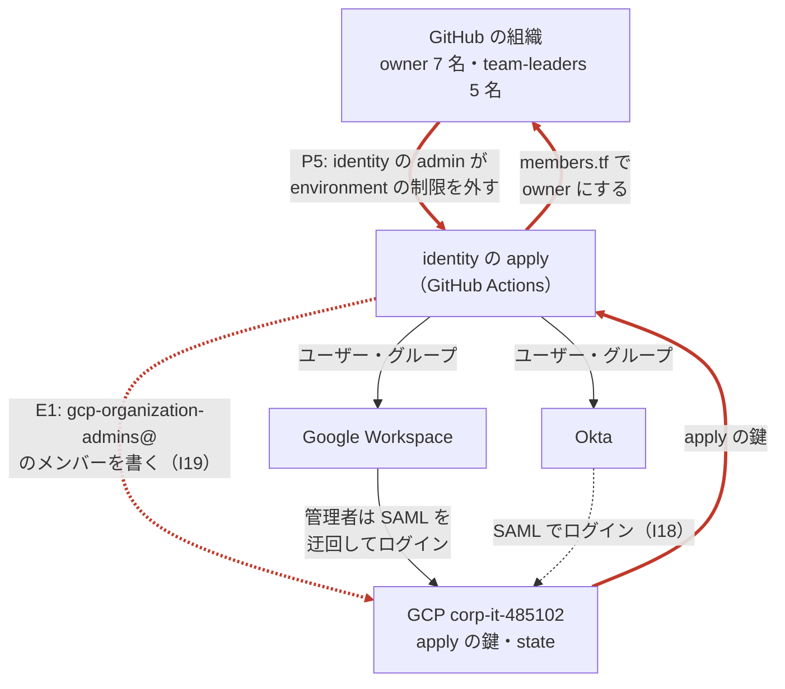
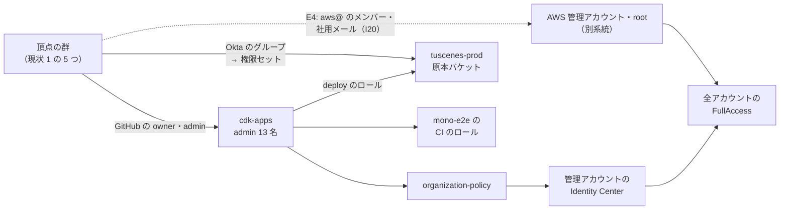
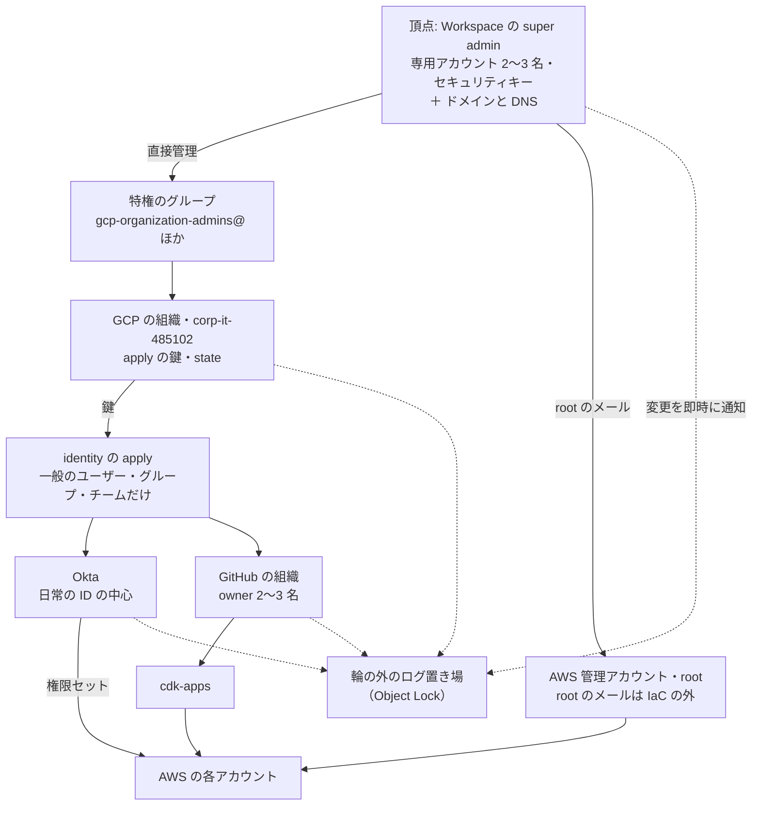

# 権限の地図: 要承認操作と名簿に届く経路

- 作成: 2026-11-02 ／ 伊藤
- 親: [権限の頂点の把握と管理](../apex-privileges.md)。きっかけは [S3 バケットのデータ保護 第二弾](../../../aws-data-protection/workstream/s3-data-protection-2.md) の [全体の状態と要件](../../../aws-data-protection/workstream/s3-data-protection-2/requirements.md) の 7 章
- 2026-11-02 に project:aws-data-protection から移した（頂点の問題を S3 の案件から分けたため）
- 状態: **GitHub の組織・identity・cdk-apps の層を調べ、あるべき姿（10 章）を考えた（2026-11-02）。** 見えない層はヒアリング項目（7 章）で CorpIT に確かめる。説明用の図のページは [apex-cycle.html](apex-cycle.html)（公開先: <https://claude.ai/artifact/Gtzn6zWuQXYW4KC2zpuMMo>）。聞き取りのシートは [corpit-hearing.md](corpit-hearing.md)

S3 の案件で、要承認操作の 2 人目の確認（要件 12）を仕組みでどう強制するかを決める前に、流れを迂回できる経路を洗い出した資料。頂点の問題（9 章）が S3 の案件の範囲を超えるので、この project に移した。要承認操作・名簿・システム保全責任者の用語は、S3 の案件の requirements.md の 7 章による。

## 1. 調べ方

組織の権限を全部棚卸しするのではなく、次の 2 つをゴールに置き、そこへ届く経路を逆向きにたどる。**1 人で届く経路が、穴**になる。

- **ゴール 1: 要承認操作を実行できる**（[requirements.md](../../../aws-data-protection/workstream/s3-data-protection-2/requirements.md) の 7.2）
- **ゴール 2: 名簿（システム保全責任者）を書き換えられる。** 名簿を GitHub のチームにすると、実体は cdk-apps の `.github/CODEOWNERS`（どのファイルを誰が承認するか）と、identity の `platform/github/team_memberships.tf`（チームに誰がいるか）の 2 か所になる

見た時点: cdk-apps `main` 0ca7e31e・identity `main` ed1f678（どちらも 2026-11-02 に取得）。GitHub の API は伊藤のアカウント（組織では member、cdk-apps では admin、identity では write）で読んだ。

## 2. 経路の一覧

| # | 層 | 経路 | 持つ人 | 1 人で届くか | 届くゴール |
|---|---|---|---|---|---|
| P1 | GitHub の組織 | 組織の owner が、画面でチーム・ルールセット・リポジトリの設定を直接変える | 7 名: 渡辺 晃平・棚橋 耕太郎・安本 雅啓・渡邉 礁太郎・山本 修平・山下 卓也・山口 祐 | はい | 1・2 |
| P2 | GitHub の組織 | `team-leaders` の組織のロール `all_repo_admin` で、全リポジトリの admin になる | 5 名: 妹尾 卓磨・徳弘 賢人・山口 祐・安本 雅啓・塩塚 大気 | はい | 1・2 |
| P3 | cdk-apps | admin がルールセット `main-image-digest-auto-merge` を無効にして、承認なしでマージする | 13 名: P1・P2 の 10 名と、犬塚 眞太郎・岩政 公平・伊藤 祐策（5.2） | はい | 1・2 |
| P4 | GitHub の組織 | チームの maintainer が、画面で人を足す（admin を持つチームなら、そのまま P3 に届く） | チームごと（3.3。例: `team-mlops-1-admin` は犬塚 眞太郎・安本 雅啓・岩政 公平） | はい | 1・2 |
| P5 | identity | admin が environment `github-prod` のブランチの制限を外し、自分のブランチから apply の鍵を取る | identity の admin（P1・P2 とみられる） | はい | 2（組織全体） |
| P6 | identity | PR で `team_memberships.tf` などを変える。承認は CorpIT の 1 名 | 作者は write を持つ人（`all_repo_write` で 11 チーム）、承認は 2 名（山本 修平・山下 卓也）のどちらか | 承認者 1 人と組めば | 2 |
| P7 | identity | admin は承認なしでマージできる（`enforce_admins` が無効と CODEOWNERS の注記にある） | identity の admin | はい | 2 |
| P8 | GCP | apply の App の鍵（Secret Manager）を読む、または apply のサービスアカウントを名乗る | 不明 | 不明 | 2（組織全体） |
| P9 | cdk-apps | 原本バケットの共通部（`packages/original-bucket-guard`）を含む `*` の承認は、MLOps 1・3 の 1 名 | 7 名（MLOps 1: 犬塚・安本・岩政・伊藤、MLOps 3: 寺西・加藤・渡邉 孝文） | 承認者 1 人と組めば | 1 |
| P10 | cdk-apps | 企画 1・OTA のアプリは、それぞれのチームの 1 名の承認でマージできる。deploy のロールは共通なので、原本バケットにも届く（W2） | 企画 1（海老澤 颯・塩塚 大気・塚本 周平）・徳弘 賢人（rescircuit）・安部 敦（piste-jp） | 承認者 1 人と組めば | 1 |
| P11 | cdk-apps | `.github/CODEOWNERS` の変更は、山本 修平（yamashush）・安本 雅啓（MasahiroYasumoto） の 1 名の承認 | 2 名（山本 修平・安本 雅啓） | 承認者 1 人と組めば | 2 |
| P12 | cdk-apps | 承認のあとに作者が変更を足しても、承認し直しが要らない（`require_last_push_approval`・`dismiss_stale_reviews_on_push` が無効） | PR の作者 | 承認者が気づかなければ | 1・2 |
| P13 | cdk-apps | 自動マージの App（`cdk-apps-auto-merge`）が、承認なしでマージできる（W3） | App の鍵 | 鍵が漏れれば | 1・2 |
| P14 | AWS | 管理アカウントの管理者、`organization-policy` の deploy の経路、tuscenes-prod の FullAccess・root など | [current-state.md](../../../aws-data-protection/workstream/s3-data-protection-2/current-state.md)・[AWS の権限の階層](../../../aws-data-protection/documents/aws-privilege-hierarchy.md) | はい | 1 |

「1 人で届く」の P1〜P5・P7 は、どれも**使っても誰にも通知されない**。identity の GitHub の Terraform には定期の差分の検知が無く（apply は `platform/github/**` を変えた `main` への push のときだけ）、画面で直接変えた設定は、次の apply まで残る。

## 3. GitHub の組織の層

### 3.1 組織の owner（P1）

7 名: 渡辺 晃平（khwatanabe）・棚橋 耕太郎（kotarotanahashi）・安本 雅啓（MasahiroYasumoto）・渡邉 礁太郎（sangotaro）・山本 修平（yamashush）・山下 卓也（yc-5997）・山口 祐（ymgaq）（API とidentity の `members.tf` の `role = "admin"` が一致）。組織のプランは Team。

owner は組織の設定をすべて変えられる。組織のルールセット・入っている GitHub App・外部の協力者・2 要素認証の必須化は、owner でないと見えない（伊藤のアカウントでは 403・404）。

### 3.2 組織のロール（P2）

identity の `org_roles.tf` で管理している。

| ロール | チーム |
|---|---|
| `all_repo_admin`（全リポジトリの admin） | `team-leaders`: 妹尾 卓磨（takuseno）・徳弘 賢人（rescircuit）・山口 祐（ymgaq）・安本 雅啓（MasahiroYasumoto）・塩塚 大気（Daiki-Shiotsuka） |
| `all_repo_write`（全リポジトリの write） | corporate-it・driving-ai-1〜4・driving-system・infrastructure・mlops-1・mlops-3・planning-1 |

`all_repo_admin` で付いた admin は、リポジトリの協力者の API（`collaborators?permission=admin`）に出てこない。2026-10-20 の調査の人数と食い違ったのはこのため。

### 3.3 チームの maintainer（P4）

maintainer は、チームに人を足せる（画面で直接。identity の PR を通らない）。admin を持つチームの maintainer は、1 人で誰にでも admin を渡せる。

| チーム | 持つ権限 | maintainer（API） |
|---|---|---|
| `team-leaders` | 全リポジトリの admin | 山口 祐（ymgaq）・安本 雅啓（MasahiroYasumoto） |
| `team-mlops-1-admin` | cdk-apps の admin | 犬塚 眞太郎（graph226）・安本 雅啓（MasahiroYasumoto）・岩政 公平（colum2131） |
| `team-corporate-it` | 全リポジトリの write。identity の権限まわりのファイルの Code Owner | 山本 修平（yamashush）・山下 卓也（yc-5997） |

## 4. identity の層

### 4.1 変更の流れ

GitHub の組織の中の「誰がどこに入れるか」（メンバー・owner・チーム・チームの権限・組織のロール・mono-e2e のルールセット）を Terraform で管理する。cdk-apps のルールセットは管理の外。

- PR を出すと plan が走る（読み取りの App）。`main` にマージすると apply が走る（書き込みの App）。
- 書き込みの App の権限は、組織の Members の書き込みと、**全リポジトリの Administration の書き込み**。Administration の書き込みがあれば、どのリポジトリのルールセットやブランチの保護も変えられる。
- 書き込みの App の鍵は GCP の Secret Manager（プロジェクト `corp-it-485102`）にあり、サービスアカウント `tf-github-apply@` を名乗れるのは `repo:turingmotors/identity:environment:github-prod` の `sub` だけ。environment `github-prod` は、ブランチの制限で `main` だけ。
- Action は SHA で固定してある。

### 4.2 承認

- CODEOWNERS: 全体は 山本 修平（yamashush）。GitHub と Okta の権限まわりのファイル（`members.tf`・`team_memberships.tf`・`teams.tf`・`org_roles.tf` など）は、`team-corporate-it`（yamashush・yc-5997）が加わり、**どちらか 1 名**の承認で足りる。Okta のユーザーとグループのメンバーは、齋藤 諒子（ryokosaito-rgb）（外部の協力者、write）も承認できる。
- identity にはルールセットが無く、従来のブランチの保護を使っている（README に「PR + 1 approval」）。保護の設定は admin にしか見えない。
- CODEOWNERS の注記では `enforce_admins` は無効。README には「admins included」とあり、食い違っている（P7）。

### 4.3 identity の admin が届くところ（P5）

identity の admin は、environment `github-prod` のブランチの制限を変えられる。制限を外せば、自分のブランチの workflow が `environment:github-prod` の `sub` を得て、書き込みの App の鍵を取れる。**identity の admin は、組織の owner と同じ力を持つ**とみてよい。

identity の admin は、API では P1 の 7 名。P2 の `team-leaders` も、組織のロールで admin になっているとみられる（API の一覧には出ない）。

## 5. cdk-apps の層

### 5.1 `main` の保護

ルールセット `main-image-digest-auto-merge`（リポジトリの単位、有効）: 削除の禁止・force push の禁止・PR 必須・承認 1 名・Code Owner の承認・squash だけ。`require_last_push_approval` と `dismiss_stale_reviews_on_push` は無効（P12）。迂回できるのは App `cdk-apps-auto-merge`（Integration 4444115）の PR だけ（P13）。

従来のブランチの保護は無い。ルールセットは、リポジトリの admin が変えられる（P3）。

### 5.2 admin（P3）

13 名。

| 経路 | 人 |
|---|---|
| 組織の owner | 渡辺 晃平（khwatanabe）・棚橋 耕太郎（kotarotanahashi）・安本 雅啓（MasahiroYasumoto）・渡邉 礁太郎（sangotaro）・山本 修平（yamashush）・山下 卓也（yc-5997）・山口 祐（ymgaq） |
| `team-leaders`（`all_repo_admin`） | 上と重ならない人: 妹尾 卓磨（takuseno）・徳弘 賢人（rescircuit）・塩塚 大気（Daiki-Shiotsuka） |
| `team-mlops-1-admin` | 上と重ならない人: 犬塚 眞太郎（graph226）・岩政 公平（colum2131）・伊藤 祐策（ito-yusaku-turing） |

### 5.3 CODEOWNERS（P9〜P11）

| パス | Code Owner（どれか 1 つの承認で足りる） |
|---|---|
| `*`（`packages/original-bucket-guard` を含む） | team-mlops-1（犬塚 眞太郎・安本 雅啓・岩政 公平・伊藤 祐策）・team-mlops-3（寺西 裕紀・加藤 祐二・渡邉 孝文） |
| `apps/organization-policy/`・その workflow・`.github/CODEOWNERS`・`.npmrc` | 山本 修平（yamashush）・安本 雅啓（MasahiroYasumoto） |
| 企画 1 のアプリ 3 本とその workflow | team-planning-1（海老澤 颯・塩塚 大気・塚本 周平） |
| `apps/databricks/`・`apps/backend-api/`・`package-lock.json` | team-mlops-1・team-mlops-3・team-planning-1 |
| `apps/ota*`・その workflow | 徳弘 賢人（rescircuit）・安部 敦（piste-jp） |

tuscenes-prod の deploy のロールはアプリに関係なく 1 組なので、どのアプリの PR からでも原本バケットの設定を変えられる（W2）。原本バケットに触れる変更を、特定の人の承認に回す仕組みは無い。

### 5.4 environment

`auto-merge`（ブランチの制限だけ）と `copilot`。承認者の設定は、Team プランの非公開リポジトリでは使えない。

## 6. 調べていない層

| 層 | 見たいこと | 見られない理由 | 頼む先 |
|---|---|---|---|
| GitHub の組織の設定 | 組織のルールセット、入っている GitHub App とその権限、外部の協力者、2 要素認証の必須化、監査ログ、webhook | owner でないと見えない | 組織の owner（CorpIT） |
| identity のブランチの保護 | `enforce_admins`、古い承認の取り消し、最後の push の承認 | admin でないと見えない | CorpIT |
| GCP（`corp-it-485102`） | Secret Manager の鍵を読める人、`tf-github-apply@` を名乗れる人、プロジェクトの owner | devbox の gcloud にユーザーのログインが無い（ADC だけ）。伊藤の権限で見えるかも未確認 | CorpIT |
| AWS の管理アカウント | 管理者、Identity Center の管理者、委任管理者、SCP・RCP の中身と付け先 | tuscenes-prod からは見えない | CorpIT |
| Okta | 管理者、AWS の権限につながるグループ | identity のコードから一部だけ見える | CorpIT |

## 7. ヒアリング項目

設計を整理してから、まとめて確かめる（2026-11-02、伊藤）。CorpIT は別の部署としてではなく、一体となって取り組む相手として扱う。不明点が出たら、ここに足す。番号は I（Inquiry）の通し番号。「聞く先」は、情報や設定を持っている人。

| # | 聞くこと | なぜ要るか | 聞く先 | 状態 |
|---|---|---|---|---|
| I1 | GitHub の組織の owner が 7 名である理由。減らせるか | 構造上の上位権限者（8 章）を絞るため | CorpIT | 未 |
| I2 | GitHub の組織に入っている App と、その権限の一覧 | Administration や Members の書き込みを持つ App は、上位権限者にあたる | CorpIT（owner） | 未 |
| I3 | 外部の協力者の一覧と、その権限 | 名簿や流れに届く人の漏れを無くすため | CorpIT（owner） | 未 |
| I4 | 組織のルールセットの有無と中身、2 要素認証の必須化 | 組織の層の守りを把握するため | CorpIT（owner） | 未 |
| I5 | identity の `main` のブランチの保護（`enforce_admins`・古い承認の取り消し・最後の push の承認）。README と CODEOWNERS の注記の食い違い | P7 が本当にあるか | CorpIT | 未 |
| I6 | `team-leaders` が `all_repo_admin` を持つ理由。identity と cdk-apps の admin でもあるか | P2・P5 の範囲 | CorpIT | 未 |
| I7 | GCP の `corp-it-485102` で、`github-apply-private-key` を読める主体と、`tf-github-apply@` を名乗れる主体。プロジェクトの owner | P8 | CorpIT | 未 |
| I8 | GitHub の組織の監査ログか webhook で、チーム・メンバー・ルールセット・environment の変更を即時に通知できるか | 上位権限者が使われたら通知する（要件 10） | CorpIT（owner） | 未 |
| I9 | identity の GitHub の Terraform に、差分の定期の検知を足せるか | 画面での直接の変更に気づくため | CorpIT | 未 |
| I10 | AWS の管理アカウントの管理者（人数と人）、Identity Center の管理者、委任管理者 | P14。構造上の上位権限者の台帳 | CorpIT | 未 |
| I11 | tuscenes-prod に効く SCP・RCP の一覧と、Control Tower のガードレールの中身 | [current-state.md](../../../aws-data-protection/workstream/s3-data-protection-2/current-state.md) の残りの調べ | CorpIT | 未 |
| I12 | 管理画面で直接した SSO の割り当て（`organization-policy` の外のもの）があるか | 例外の権限セットに届く人の漏れ | CorpIT | 未 |
| I13 | Okta の管理者と、AWS の権限セットにつながるグループを変えられる人 | Okta から FullAccess を付けられる経路 | CorpIT | 未 |
| I14 | 管理アカウントの root の管理（誰が持ち、どう保管しているか） | 最上位の上位権限者 | CorpIT | 未 |
| I15 | identity の environment `okta-prod`・`google-workspace-prod` のブランチの制限を、identity の admin が外せるか（P5 と同じ手口） | 頂点の群のつながり（9 章） | CorpIT | 未 |
| I16 | Google Workspace の特権管理者と、GCP の組織・`corp-it-485102` の管理者は誰か | 頂点の群の人 | CorpIT | 一部（2026-11-02。実質の最高権限者は 4 名。Workspace の super admin かどうかは I26） |
| I17 | Okta の特権管理者は誰か。Okta の管理者のアカウントにかかる要件（MFA・専用のアカウントなど） | 頂点の群の人 | CorpIT | 未 |
| I18 | GCP の権限を持つ人のログインは Okta の SAML 経由か。SAML を迂回できる管理者は誰か | Okta から GCP へのつながり（推定）の確認 | CorpIT | 一部（2026-11-02。Okta を飛ばしてログインできるのは GCP だけ。誰が迂回できるかは未） |
| I19 | Workspace のグループ `gcp-organization-admins@`・`gcp-security-admins@` に、GCP の組織と `corp-it-485102` で何のロールが付いているか | identity の apply で GCP の組織管理者になれるか（10.2 の辺 E1） | CorpIT | 未 |
| I20 | `aws@`（名前は「AWS Admins」）の用途。AWS の root や管理アカウントのメールか。誰に届くか | apply でメンバーを足せば、root の回復のメールを受け取れるか（辺 E4） | CorpIT | 未 |
| I21 | Okta の apply の App（CD 用）に付いている管理ロール。独自の最小のロールか、Organization Administrator か | README の推奨どおりかどうかで、Okta への辺の太さが変わる | CorpIT | 未 |
| I22 | ドメイン（turing-motors.com）のレジストラと DNS の管理者、そのログインの方法 | MX を変えれば全サービスの回復のメールを奪える。頂点の一部 | CorpIT | 未 |
| I23 | Workspace の super admin のアカウントは、普段使いと分けているか。ログインは Okta を通るか、セキュリティキーは必須か | 頂点の人の要件（10.3）の今の状態 | CorpIT | 未 |
| I24 | break-glass の資格情報（AWS の root、super admin、GitHub の回復コードなど）の置き場。Keeper（Okta の App）に置いているか | 置き場が Okta の下なら、輪が残る | CorpIT | 未 |
| I25 | GitHub の owner のアカウントの登録のメールと回復の手段は、会社のドメインか個人か | 会社の管理の外にある回復の経路 | CorpIT | 未 |
| I26 | 実質の最高権限者の 4 名が持っているのは、GCP の組織管理者か、Workspace の super admin か、両方か。Workspace の super admin はこの 4 名だけか | 4 名の外に super admin がいれば、その人も頂点になる（10.1） | CorpIT | 未 |
| I27 | 止められている循環（9.1 の C1〜C4）はどれか。どの仕組みで止めているか | 構造上の経路と、実際の経路を分ける | CorpIT | 未（2026-11-02 に「いくつかは止めてある」とだけ聞いた） |
| I28 | GitHub の owner のうち、4 名に入らない 4 名（棚橋 耕太郎・安本 雅啓・渡邉 礁太郎・山下 卓也）の位置付け。C1 は止められているか | C1 が通るなら、この 4 名も実質の最高権限者に近い | CorpIT | 未 |

## 8. 構造上の上位権限者の台帳

仕組みの構造の上で、システム保全責任者より上に立つ権限。無くせないので、**何が存在しているかを把握し、管理を徹底する**（[requirements.md](../../../aws-data-protection/workstream/s3-data-protection-2/requirements.md) の 7.4、2026-11-02、伊藤）。流れには組み込まず、名簿の行き詰まりと流れの故障のときだけ、最後のエスケープハッチとして使う。

管理の列は、目指す形（数を絞る・使えば即時に通知する・残るリスクとして明記する）に対する今の状態。

| # | 上位権限 | 届くところ | 持つ人・数 | 把握 | 管理（今） |
|---|---|---|---|---|---|
| U1 | GitHub の組織の owner | 組織のすべて（チーム・ルールセット・リポジトリ・App） | 7 名: 渡辺 晃平・棚橋 耕太郎・安本 雅啓・渡邉 礁太郎・山本 修平・山下 卓也・山口 祐（3.1） | 人は分かる | 絞っていない。通知なし |
| U2 | 組織のロール `all_repo_admin` | 全リポジトリの admin（ルールセット・environment・secret） | `team-leaders` 5 名: 妹尾 卓磨・徳弘 賢人・山口 祐・安本 雅啓・塩塚 大気（3.2） | 人は分かる | 絞っていない。通知なし |
| U3 | 対象のリポジトリの admin | cdk-apps: ルールセットを外して承認なしでマージ。identity: apply の鍵を取って組織を書き換え | cdk-apps 13 名: U1・U2 の 10 名と、犬塚 眞太郎・岩政 公平・伊藤 祐策（5.2）。identity は U1 と、おそらく U2（I6） | cdk-apps は分かる。identity は一部 | 絞っていない。通知なし |
| U4 | admin を持つチームの maintainer | チームに人を足して U2・U3 を渡す | `team-leaders`: 山口 祐・安本 雅啓。`team-mlops-1-admin`: 犬塚 眞太郎・安本 雅啓・岩政 公平。`team-corporate-it`: 山本 修平・山下 卓也（3.3） | 主なチームは分かる | 通知なし |
| U5 | identity の書き込みの App とその鍵 | 組織の Members と、全リポジトリの Administration の書き込み | 鍵は GCP の Secret Manager。届く主体は不明（I7） | App は分かる。鍵に届く主体は不明 | `main` と environment に縛ってある。通知なし |
| U6 | そのほかの GitHub App | 権限による | 不明（I2） | 不明 | 不明 |
| U7 | GCP（CorpIT が最上位に置いているシステム）の管理者 | U5 の鍵、identity の state。Okta を飛ばしてログインできる | CorpIT によれば、実質の最高権限者は 4 名: 渡辺 晃平・山口 祐・山本 修平・大戸 一希（2026-11-02）。権限の中身は I26、`corp-it-485102` の個別の主体は I7 | 人は分かる（口頭） | 4 名に絞ってある（口頭）。通知は不明 |
| U8 | AWS の管理アカウントの管理者と root | 全メンバーアカウント。バケットポリシーも外せる | 不明（I10・I14） | 不明 | 不明 |
| U9 | `organization-policy` の deploy の経路 | 誰にでも任意のアカウントの FullAccess を付ける | 承認は 山本 修平（yamashush）・安本 雅啓（MasahiroYasumoto） の 1 名（[AWS の権限の階層](../../../aws-data-protection/documents/aws-privilege-hierarchy.md)） | 分かる | CODEOWNERS だけ。最後の push の承認なし |
| U10 | Okta の管理者 | AWS の権限セットにつながるグループ | 不明（I13） | 不明 | 不明 |
| U11 | tuscenes-prod の root | tuscenes-prod のすべて | — | 分かる | 認証情報の削除を CorpIT に依頼中（[aws-root-credentials.md](../../../aws-data-protection/workstream/aws-root-credentials.md)） |

範囲の外: GitHub・AWS・GCP・Okta の提供者自身（要件 8 の「AWS 自体の障害」と同じ扱い）。

## 9. 上位の構造と、その評価（2026-11-02）

### 9.1 構造

一直線の階層ではない。**互いに届き合う「頂点の群」**があり、その下に枝が付いている。推定を含む（I15〜I18）。

図 1: 輪の中心（太い赤の辺が輪を閉じている。点線は推定）

致命的な循環（出発点に戻ってくる経路。上ほど確かで、届く人が多い）:

- **C1: GitHub の owner・admin → identity → GitHub（確認済み。1 人で、通知なし）**
  - 経路: identity の admin として environment `github-prod` のブランチの制限を外す（P5）→ 自分のブランチの workflow で apply の鍵を得る → `members.tf` で自分や誰かを owner にする、またはどのリポジトリの保護も外す。
  - 届く人: owner 7 名と、`team-leaders` の残り 3 名（I6 で確かめる）。
  - 画面での直接の変更は差分の検知も無いので、痕跡が次の apply まで残る。
- **C2: identity の PR → 特権のグループ → GCP → すべての apply の鍵（I19 次第）**
  - 経路: `gcp-organization-admins@` のメンバーに自分を足す PR をマージする → apply で Workspace のグループが変わる → GCP の組織管理者になる → Secret Manager の GitHub・Okta・Workspace の apply の鍵すべてに届く（E1）。
  - 届く人: owner・admin だけではない。write を持つ人が、CorpIT の 1 名の承認と組めば届く（P6）。`enforce_admins` が無効なら、admin は承認なしで届く（P7・I5）。
  - グループに組織管理者のロールが付いていなければ、この経路は無い。**I19 が最優先の確認**。
- **C3: GCP の管理者 → apply の鍵 → GitHub の owner → C1（人は不明）**
  - 経路: `corp-it-485102` の管理者が鍵を読むか `tf-github-apply@` を名乗る（P8）→ GitHub・Okta・Workspace に書き込み、自分を GitHub の owner にする。そうすると、GCP の権限を外されても、C1 と C2 で GCP に戻れる（輪の中で足場を作り直せる）。
  - 届く人: 不明（I7・I16）。
- **C4: Okta の管理者 → GCP → apply の鍵 → Okta（推定）**
  - 経路: Okta から SAML で GCP にログインしている（I18）→ Okta の管理者が GCP の管理者になりすます → 鍵を得る。
  - Okta の apply の App の管理ロールが広ければ（I21）、戻りの辺も太くなる。

**CorpIT によれば、C1〜C4 のいくつかは止められている**（2026-11-02）。どれが、どの仕組みで止まっているかは未確認（I27）。確かめるまで、この一覧は「構造の上で通りうる経路」として残す。

**循環に入っていないもの: Workspace の super admin。** apply は Workspace の管理者ロールと SSO の設定には書けないので、super admin へ戻る辺が無い（8b8e953 で確認）。Workspace の super admin は、すでに一方向の頂点にいる。10 章で頂点に据える根拠の 1 つ。

図 2: 輪から下に伸びる枝

- GitHub へのログインは Okta を通らない（identity の README の Service List）。
- mono-e2e は、AWS の側では cdk-apps の下（cdk-apps が定義したロールの範囲でしか届かない）。GitHub の側では cdk-apps と横並び。
- AWS の管理アカウントは、AWS の中ではすべてに届くが、GitHub・Okta・GCP には届かないとみられる。

### 9.2 評価: 要件 7（乗っ取り）に対して、良くない状況

**頂点の群の誰か 1 人のアカウントが乗っ取られると、ほぼすべてに届く。** そういう人が、分かっているだけで 10 名（組織の owner 7 名と、identity の admin とみられる `team-leaders` の残り 3 名）いる。GCP・Okta・Google の管理者は、人数も分からない。

良くない点:

1. **頂点が広く、境界が見えない。** 1 人で全体に届く人が 10 名を超え、残りの層は見えない。把握と管理を徹底する方針（7.4）の出発点に、まだ立てていない。
2. **輪になっているので、頂点どうしで見張り合えない。** 1 つの頂点が乗っ取られると、ほかの頂点にも足場を作れる。どの頂点に置いた通知や守りも、別の頂点から外せる。輪の外に、最後に頼れる場所が無い。
3. **丁寧に作った境界を、境界を変えられる人が多すぎる。** identity は「PR と承認、`main` だけ、鍵は GCP、Action は SHA で固定」と丁寧に作られている。ただ、境界の `main` の保護と environment の制限は、admin が 1 人で変えられる。`enforce_admins` も無効とみられる。
4. **使われても誰にも通知されない。** 画面での直接の変更は、差分の定期の検知も無い。
5. **人に集中している。** 安本 雅啓さんと山本 修平さんは、頂点の群の複数の経路と、承認者を兼ねる。この 2 人のアカウントは狙われやすく、不在のときに止まる。
6. **GitHub の Team プランの制約。** environment の承認者・独自のロール・監査ログの転送が使えず、仕組みで絞る手段が少ない。

ただし、珍しい状況ではない。ID 基盤が自分自身をコードで管理すると、こういう輪ができやすい。identity の設計は、鍵を人に配らない点などで、よくある形より丁寧である。問題は、**輪の頂点に立つ人の数と、その使われ方が見えないこと**にある。

### 9.3 S3 の案件の設計への影響

- **GitHub の上の 2 人の確認は、頂点の群の乗っ取りには効かない。** 頂点の群の 1 人が乗っ取られれば、ルールセットも名簿も外せる。2 人の確認が効くのは、ふつうの経路（誤操作、ふつうのメンバーの乗っ取り）まで。これを明記したうえで進める。
- **頂点の群に頼らない守りは、WORM の時間の猶予だけ。** ホールドを外されても、消せるまで 30 日ある。ただし、通知を受ける場所も頂点の群から外せるので、通知は輪の外（たとえば、AWS と GitHub のどちらからも止められない受け手）に届く形が要る。
- **「上位者を置かない」方針の中身は、頂点の群を狭めることになる。** S3 の案件では扱わず、この project で CorpIT と一体で取り組む。手の付け方の候補:
  - 狭める: 組織の owner を減らす。`all_repo_admin` を外す。identity の `enforce_admins` を有効にする。GCP・Okta・Google の管理者を最小にする。
  - 見える化: owner の操作・ルールセット・environment・GCP の IAM と Secret Manager・Okta のシステムログの変更を、即時に通知する。
  - 頂点の人の要件: フィッシングに強い MFA、普段使いと分けた管理用のアカウント（[特権アクセスと break-glass の一般論](../../../aws-data-protection/documents/privileged-access-and-break-glass.md)）。
  - 頂点に頼らない層: WORM（コンプライアンス）と、輪の外への通知。

## 10. あるべき姿（2026-11-02 の考察）

9 章の輪をほどき、頂点を 1 か所に据えたときの形。セカンドオピニオン（別のエージェントの独立した考察）と突き合わせて、伊藤と考えた。結論は案で、ヒアリング（I19〜I25 ほか）の結果で見直す。

### 10.1 真の頂点: Google Workspace の特権管理者

**頂点には、Google Workspace の super admin（数名の専用アカウント）と、ドメイン・DNS を据える。** 理由:

- **設計の上で、すでに Okta より上にいる。** identity の README の state の行に「GCP は管理者が SAML を bypass してログインできるため、Okta を壊しても state に到達でき」とある（8b8e953 で確認）。Okta が壊れたときの戻り道として、意図して Workspace の側に置いている。
- **社用メールは、ほかのサービスの回復の起点になる。** Okta・GitHub・AWS の root は、メールでパスワードを戻せる（推定。各サービスの回復の設定は未確認）。
- **ほかの候補は頂点に向かない。**
  - Okta: 日常の ID の中心だが、メールと SAML の迂回を Workspace から引き剥がせない。
  - GitHub: Team プランでは SSO を強制できず、owner の個人アカウントの回復の手段が会社の管理の外にある。
  - identity: 頂点ではなく、変更の経路。鍵は GCP にある。
  - GCP: Workspace（Cloud Identity）の配下にある。
  - AWS の管理アカウント: AWS の中の頂点として別系統に残す。ただし root のメールは Workspace の下にある。

**CorpIT の認識（2026-11-02 の聞き取り）:** すでに GCP を最上位の権限者を持つシステムにしてあり、実質の最高権限者は 4 名（渡辺 晃平・山口 祐・山本 修平・大戸 一希）。GCP にした理由は、GCP だけは Okta を飛ばしてログインできるから。

この案との関係: 頂点を「Google の側（Okta の外）」に置く考えは、CorpIT の設計と一致している。違うのは、頂点を GCP と呼ぶか、Workspace の super admin と呼ぶかだけとみられる。GCP の組織は Workspace（Cloud Identity）のドメインに属し、Okta を飛ばすログインも Workspace の SSO の設定で決まるので、Workspace の super admin は GCP の権限を自分に付けられる（推定。Google の一般的な仕組みによる）。確かめるのは、4 名が Workspace の super admin でもあるか、4 名の外に super admin がいないか（I26）。4 名と super admin が一致していれば、この案の頂点は、すでにほぼできている。

頂点は「システム」ではなく「**日常に使わない数名の専用アカウント**」と考える。Workspace は毎日使う SaaS で、フィッシングに最も狙われやすい。頂点を Workspace 全体ではなく専用アカウントに限ることで、この弱点を打ち消す。

並べ直した形（矢印は一方向）:

原則: **下の層は、自分の管理者を守る仕組みに書き込めない。**

### 10.2 ほどく辺

identity（8b8e953）で確かめたこと:

- Workspace への apply は、管理者ロールと SSO の設定には届かない。Okta への apply も、scope に `okta.policies.*` が無く、認証ポリシーには届かない（`platform/okta/README.md`）。辺を切れば頂点に届かなくなる素地はある。
- ただし、identity の Terraform は、Workspace のグループ `gcp-organization-admins@`・`gcp-security-admins@`・`aws@`（「AWS Admins」）のメンバーを管理している（`platform/google-workspace/groups/`）。

| # | 辺 | 今 | ほどき方 |
|---|---|---|---|
| E1 | identity → 特権のグループ（`gcp-organization-admins@` など）→ GCP の組織管理者 → Secret Manager のすべての鍵 | グループに組織管理者のロールが付いていれば、apply 1 回で頂点に上れる（I19。**輪を閉じている最重要の辺**） | 特権のグループを apply の書き込みの対象から外し、super admin が直接管理する。identity は差分の検知だけにする |
| E2 | Okta → GCP・Workspace の管理者 | 管理者が Okta を通ってログインしていれば、Okta の管理者が頂点に届く（I18・I23） | 管理者の専用アカウントは SSO プロファイルで Okta から外し、Google 自身のログインとセキュリティキーにする |
| E3 | GitHub の owner・identity の admin → apply の鍵（P5） | Team プランでは、environment の承認者が使えず断てない | E1 を切って apply の届く範囲を「一般のユーザー・グループ・チーム」に縮め、被害を有限にする |
| E4 | identity → `aws@` → AWS の root のメール | `aws@` が root のメールなら、apply でメンバーを足して回復のメールを受け取れる（I20） | root のメールを、IaC の管理の外で super admin だけが触れるアドレスに移す |
| E5 | break-glass の資格情報 → Keeper（Okta の App） | 置いていれば、Okta の管理者が頂点の資格情報に届く（I24） | Okta に依存しない置き場（物理の保管など）に分ける |

### 10.3 段階案

1. **確かめる。** I19〜I25 と、I7・I14・I16・I17。
2. **数を絞る。**
   - GitHub の owner を 7 名から 2〜3 名にする。`all_repo_admin` を外す。identity の `enforce_admins` を有効にする（P7 は消えるが、P5 は残る）。
   - super admin を 2〜3 名の専用アカウントにする。
3. **辺を切る。** E1・E2・E4・E5。
4. **輪の外で見張る。**
   - Workspace の管理ログ、GCP の IAM と Secret Manager へのアクセス、Okta のシステムログ、GitHub の組織の変更（member・team・ruleset・branch protection・environment）を、即時に通知する。
   - 送り先は、輪から書き換えられない場所にする（例: Object Lock を掛けたログ専用の AWS アカウント。S3 の案件の WORM と同じ考え方）。
   - GitHub Enterprise への移行（SAML・environment の承認者・監査ログのストリーミング）は、費用と見合いで判断する。

### 10.4 残るもの・反論

- **「CD がすべて GitHub で動く以上、実質の根は GitHub の owner だ」という反論は、半分正しい。** E1 を切っても、GitHub の owner は cdk-apps を通して AWS の大部分に届く。頂点ではないが**最も大きな枝**として、台帳（8 章）に残るリスクとして明記する。
- **頂点に置かない、ほかの隠れた経路。**
  - identity の apply の「エイリアスの追加」で、使われていない古いアドレス宛てのメールを奪う（推定）。
  - state のバケット（apply のサービスアカウントは書き込める）の改ざん。
  - 組織に入っている App や AI エージェント（I2）。
  - 各 SaaS のサポートによるアカウントの回復（ソーシャルエンジニアリング）。

## 11. 人ごとの一覧

GitHub のアカウント名と氏名の対応は、identity の `platform/github/people.tf`（ed1f678）による。役職の注記もそこから写した。「台帳」は 8 章の U 番号、「承認」は 2 章の P 番号のうち承認者として入るもの。

| 人 | GitHub | 注記 | 台帳 | 承認 |
|---|---|---|---|---|
| 安本 雅啓 | MasahiroYasumoto | | U1・U2・U3・U4（team-leaders・team-mlops-1-admin） | P9・P11・U9 |
| 山口 祐 | ymgaq | 執行役員。実質の最高権限者（CorpIT、2026-11-02） | U1・U2・U3・U4（team-leaders）・U7 | |
| 山本 修平 | yamashush | CorpIT。実質の最高権限者（CorpIT、2026-11-02） | U1・U3・U4（team-corporate-it）・U7 | P6・P11・U9 |
| 山下 卓也 | yc-5997 | CorpIT | U1・U3・U4（team-corporate-it） | P6 |
| 大戸 一希 | kazu0716 | infrastructure のチーム。実質の最高権限者（CorpIT、2026-11-02）。GitHub の組織の owner ではない | U7 | |
| 渡辺 晃平 | khwatanabe | 実質の最高権限者（CorpIT、2026-11-02） | U1・U3・U7 | |
| 棚橋 耕太郎 | kotarotanahashi | 執行役員 | U1・U3 | |
| 渡邉 礁太郎 | sangotaro | 執行役員 | U1・U3 | |
| 妹尾 卓磨 | takuseno | | U2・U3 | |
| 徳弘 賢人 | rescircuit | | U2・U3 | P10（OTA） |
| 塩塚 大気 | Daiki-Shiotsuka | | U2・U3 | P10（企画 1） |
| 犬塚 眞太郎 | graph226 | | U3・U4（team-mlops-1-admin） | P9 |
| 岩政 公平 | colum2131 | | U3・U4（team-mlops-1-admin） | P9 |
| 伊藤 祐策 | ito-yusaku-turing | | U3 | P9 |
| 寺西 裕紀 | chantera | | | P9 |
| 加藤 祐二 | gnoilednad | | | P9 |
| 渡邉 孝文 | ohnabe | | | P9 |
| 海老澤 颯 | ebiebix | | | P10（企画 1） |
| 塚本 周平 | shuhei-tsukamoto | | | P10（企画 1） |
| 安部 敦 | piste-jp | | | P10（OTA） |
| 齋藤 諒子 | ryokosaito-rgb | 契約社員。identity の外部の協力者（write） | | identity の Okta のユーザーとグループのメンバーの承認（P6 には入らない） |

AWS の側（tuscenes-prod の FullAccess 13 名など）の人は [current-state.md](../../../aws-data-protection/workstream/s3-data-protection-2/current-state.md) にある。管理アカウント・GCP・Okta の管理者は分からない（I7・I10・I13）。
