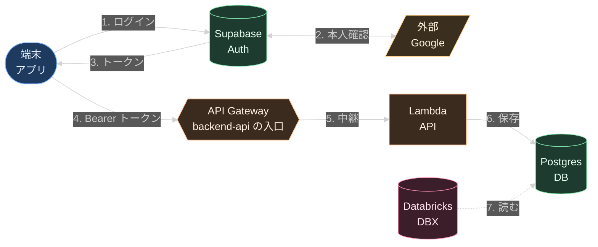

# Tern iOS アプリに Google ログインを入れ、backend-api を呼べるようにする

Notion: <https://app.notion.com/p/405a93b3e6f281208011c7ccdb174536>（この資料が原本。直すときはここを直してから Notion を更新する）

作成: 2026-10-23 ／ 伊藤

## この記事でお願いしたいこと

Tern の iOS アプリで社員が Google でログインし、そのトークンで backend-api を呼べるようにします。目的は、API キーやサービスキー（JADD_SERVICE_KEY）を使わずに、フィードバックの送信などの機能を足せるようにすることです。

- **MLOps チームの皆さん**: 「どこにどのような変更を施すのか」を読み、末尾の「合意したいこと」について、**賛成か反対か**（反対なら理由）をコメントでお知らせください。
- **三輪さん**: 「iOS アプリへの組み込み」と「作業の順番」が、想定と合っているかを確認してください。

## 背景

依頼（三輪さん）の要点は次の 3 つです。

| # | 欲しいこと | いまの形 |
|---|---|---|
| R1 | 社員が Google でログインし、アプリが「誰か」を知る | 無い。アプリは匿名 |
| R2 | Tern API（経路の計算）を API キー無しで呼ぶ | 共有の API キー 1 本を、各自が設定画面に入れる |
| R3 | ナビデータへのフィードバックを送り、Databricks から読む | 機能が無い。いまの仕組みで作ると JADD_SERVICE_KEY が要る |

今回は **R1 と R3** を進めます。R2 は Tern API 側の作業になるので、別の機会に扱います（「今回やらないこと」）。

### 決まっていること

- β テスターは**社員だけ**です。社員の Google アカウントでのログインで足ります。
- ログインには、**jadd-cli と同じ backend-prod の Supabase Auth** を使います。Supabase のプロジェクトを新しく作ることも、backend-api に新しい鍵を登録することもしません。
- フィードバックは **backend-prod の Postgres** に保存し、Databricks からは既存のカタログ `supabase_backend_prod` で読みます。Tern の回帰テストのテーブル（`tern_regression_test_*`）と並べます。
- アプリは **backend-api だけを呼びます。BFF（`api.turing-ai.dev`）は使いません。** BFF は撤廃が決まっていて、残っているのは backend-api への中継と authorizer だけです。これから作るアプリが撤廃の後に作り直しにならないよう、撤廃の後の backend-api の入口に合わせます。

### 分担

| 担当 | 範囲 |
|---|---|
| 伊藤 | ログインの経路を用意する（backend-prod の Supabase の設定と、MLOps チームとの調整）。iOS への組み込み方を示し、疎通を一緒に確かめる |
| 三輪さん | iOS アプリへの組み込み。フィードバックのテーブル・backend-api の受付・送信の画面 |
| MLOps チーム | 設定の変更と mono-e2e の変更のレビュー。backend-prod の Supabase の設定の変更。BFF の撤廃の後の backend-api の入口を、アプリから届くように用意する（BFF の撤廃の作業の中で） |

## 全体の流れ

| 図の名前 | 実体 |
|---|---|
| アプリ | Tern iOS アプリ（turingmotors/navi-ios-app） |
| Google | Google のログインの画面（社員のアカウント） |
| Auth | backend-prod の Supabase Auth（jadd-cli と共用） |
| 入口 | backend-api の API Gateway（BFF の撤廃の後の入口。URL は撤廃の作業で決まる） |
| API | backend-api（mono-e2e）。トークンは backend-api 自身が検証する（`deps/token_verifier.py`） |
| DB | backend-prod の Postgres |
| DBX | Databricks（カタログ `supabase_backend_prod` で federation） |



1〜3 は jadd-cli のログインと同じ仕組みです。4〜5 は BFF を通らず、backend-api の入口に直接届けます。トークンの検証は、BFF の authorizer ではなく backend-api 自身が行います（5 の後、6 の前）。

**新しく通る道は 2 つです。** アプリから Auth への戻り先（Redirect URL）と、アプリから backend-api の入口への直接の呼び出しです。後者は、BFF の撤廃で jadd-cli や JADD STUDIO も同じ道になります。

## どこにどのような変更を施すのか（MLOps チーム向け）

| 場所 | 変更 | 担当 |
|---|---|---|
| backend-prod の Supabase Auth | **Redirect URLs に `turingnavi://auth-callback` を 1 行足す**（スキーム名は三輪さんと決めて確定する）。Site URL・Google のプロバイダ・jadd-cli の戻り先は変えない | MLOps（設定の権限を持つ人） |
| BFF（cdk-apps の `apps/bff`） | **使わない**。アプリは BFF を経由しないので、BFF の撤廃の影響を受けない | — |
| backend-api の入口（cdk-apps の `apps/backend-api`） | **BFF の撤廃の作業で用意してもらう。** 今の API Gateway は、API Gateway の IP からの呼び出ししか受けない（BFF からの中継を前提にした resource policy）。アプリから直接届くようにし、URL を決める。Tern のためだけの変更は無い | BFF の撤廃の担当（MLOps） |
| backend-api の認証（`deps/token_verifier.py`・`deps/auth.py`） | **Tern のための変更なし。** backend-prod の JWT はすでに検証できる。ただし検証は今、BFF のスタックにある `supabase-authorizer-v3` を invoke して行っているので、BFF の撤廃の後も検証役が残るようにする必要がある（BFF の撤廃の作業の中で） | BFF の撤廃の担当（MLOps） |
| backend-api の受付（mono-e2e） | フィードバックの受付の API を足す。認可は既存の Tern 用 API と同じ判定（`deps/tern_agent.py` の `writer`。検証済みで `@turing-motors.com` の利用者だけ） | 三輪さん（レビューは MLOps） |
| db-models（mono-e2e） | フィードバックのテーブルを足す（alembic のマイグレーション）。`tern_regression_test_*` と並べる | 三輪さん（レビューは MLOps） |
| Databricks | 新しいテーブルが `supabase_backend_prod.public` から読めることを確かめる。権限の付与が要るなら足す | MLOps |
| Google Cloud の OAuth クライアント | **変更なし**。Supabase の画面でのログインにするので、既存の Web 用のクライアントのまま使える | — |
| Tern API（cdk-apps） | **変更なし**（今回やらないこと） | — |

### 変わらないこと

- **jadd-cli のログインはそのままです。** Redirect URLs は複数登録でき、アプリはログインのたびに戻り先を指定します。Site URL を書き換える必要はありません。
- **同じ社員は、jadd-cli とアプリで同じ利用者（同じ `sub`）になります。** backend-api から見ると、jadd-cli でログインした人と区別しません。

### 新しく生じること（確認をお願いしたい点）

| 点 | 中身 | こちらの考え |
|---|---|---|
| anon キーがアプリに入る | ログインとトークンの更新に、backend-prod の anon キー（公開を前提とした値）が要る。jadd-cli では各自が環境変数で渡していたが、アプリでは TestFlight のビルドに入る | anon キーは公開を前提にしたキーなので、入れてよいと考える。ただし、ログインした社員が backend-prod の PostgREST を直接呼べるので、**`public` スキーマの RLS が「認証済みなら何でも読める」になっていないか**を確かめたい |
| ログインできる人 | backend-prod の Google のログインが、社外の Google アカウントを弾くかは未確認（OAuth の同意画面が「内部」か） | 受付の API で `@turing-motors.com` を確かめるので、社外の人はフィードバックを送れない。同意画面が「内部」ならなお安全 |
| 退職者の扱い | 退職した人のトークンがいつ止まるか。アクセストークンの寿命は約 1 時間。backend-prod では、オフボーディングの同期（[mono-e2e#6139](https://github.com/turingmotors/mono-e2e/pull/6139)。10/9 から本番）が 15 分ごとに、Google で停止・削除された人を ban している | jadd-cli と同じ事情なので、今回は新しい対策をしない。ban のあと、発行済みのトークンがいつまで使えるかを教えてほしい |
| 入口の用意を待つ | アプリは BFF の撤廃の後の入口を使うので、その入口ができるまで実機からの疎通の確認ができない | 撤廃の作業の見通しを教えてほしい。入口の URL はビルドの設定で差し替えられるようにしておくので、先にできたところまで組み込める |
| ログ | フィードバックには地点（座標）が含まれうる | 受付の API では座標・本文・トークンをログに出さない（既存の Tern 用 API と同じ方針） |

## iOS アプリへの組み込み（三輪さん向け）

いまの Tern API の呼び出し（`x-api-key`）は変えません。ログインと backend-api の呼び出しを、それとは別に足します。

### 1. 設定

| 項目 | 値 |
|---|---|
| ライブラリ | supabase-swift（Swift Package Manager。使うのは Auth だけ） |
| Supabase の URL | `https://lvngtemehmcxemnurgwb.supabase.co`（backend-prod） |
| anon キー | MLOps チームから受け取る。ビルドの設定で渡す（`.env.secret` と同じ扱いにして、リポジトリに直接書かない） |
| URL スキーム | `turingnavi`（`Config/AppInfo.plist` の `CFBundleURLTypes` に登録） |
| 戻り先 | `turingnavi://auth-callback`（backend-prod の Redirect URLs と一字一句同じにする） |
| backend-api の URL | BFF の撤廃の後の backend-api の入口（未定。決まったら知らせる）。**`api.turing-ai.dev`（BFF）は使わない。** ビルドの設定で渡し、差し替えられるようにする |

### 2. ログイン

Supabase のログインの画面を `ASWebAuthenticationSession` で開き、Google でログインしてアプリに戻ります。supabase-swift がこの一連（PKCE を含む）を包んでいます。

```swift
let supabase = SupabaseClient(
  supabaseURL: URL(string: "https://lvngtemehmcxemnurgwb.supabase.co")!,
  supabaseKey: anonKey,
  options: .init(auth: .init(flowType: .pkce))
)

// ログイン（Google の画面で社員のアカウントを選んでもらう）
try await supabase.auth.signInWithOAuth(
  provider: .google,
  redirectTo: URL(string: "turingnavi://auth-callback")!,
  queryParams: [(name: "hd", value: "turing-motors.com")]  // 社員のアカウントを先に出すための指定。制限ではない
)

// ログアウト
try await supabase.auth.signOut()
```

- メソッドの細かな形は、入れる supabase-swift の版に合わせてください。
- セッションは supabase-swift が Keychain に保存し、期限が近づくと自動で更新します。
- 設定画面に、ログインの状態（メールアドレス）とログイン・ログアウトの操作を置くことを想定しています。

### 3. backend-api の呼び出し

```swift
func callBackendAPI(_ path: String, method: String = "GET", body: Data? = nil) async throws -> (Data, HTTPURLResponse) {
  let session = try await supabase.auth.session  // 期限切れなら更新してから返る
  // backendAPIBaseURL は、ビルドの設定で渡す backend-api の入口（BFF の api.turing-ai.dev ではない）
  var request = URLRequest(url: backendAPIBaseURL.appendingPathComponent(path))
  request.httpMethod = method
  request.httpBody = body
  request.setValue("Bearer \(session.accessToken)", forHTTPHeaderField: "Authorization")
  if body != nil { request.setValue("application/json", forHTTPHeaderField: "Content-Type") }
  let (data, response) = try await URLSession.shared.data(for: request)
  return (data, response as! HTTPURLResponse)
}
```

| 応答 | 意味 | アプリでの扱い |
|---|---|---|
| 200 系 | 成功 | — |
| 401 | トークンが無効（期限切れ・ログアウト済み） | 1 回だけセッションを更新して送り直す。だめならログインし直してもらう |
| 403 | 社員のアカウントでない | 「社員の Google アカウントでログインしてください」と出す |
| 503 | 認証の基盤に一時的に届かない | 少し待って送り直す |

- アクセストークン・座標・フィードバックの本文は、アプリのログにも出さないでください。

### 4. 疎通の確認

ログインした実機から、backend-api の入口にある既存の Tern 用 API を呼びます。社員のアカウントなら 200 が返り、ログイン・backend-api でのトークンの検証・`@turing-motors.com` の判定までが通ったことを確かめられます。入口が用意できてから行います。

```
GET <backend-api の入口>/tern-dev-agent/map-errors/capabilities
Authorization: Bearer <access_token>
→ 200 {"can_review": true, ...}
```

### 5. フィードバックの受付（三輪さんの作業）

- テーブル: mono-e2e の `packages/db-models` に alembic で足す。先例は `backend_models/tern_regression_test.py`
- 受付: backend-api に足す。認可は `deps/tern_agent.py` の `writer` と同じ判定を使い、送った人は JWT の `sub` と email で記録する
- 決めること: ログインを必須にするか、フィードバックを送るときだけにするか（オフラインの経路の計算は、いまもログイン無しで使える）

## 作業の順番

| 順 | 作業 | 担当 | 終わりの目安 |
|---|---|---|---|
| 1 | URL スキーム名を決める（例: `turingnavi`） | 三輪さん・伊藤 | 戻り先の URL が 1 つに決まる |
| 2 | この記事のレビュー。anon キーの配布・RLS・同意画面・退職者の扱いを確かめる | MLOps チーム | 「合意したいこと」に回答がそろう |
| 3 | backend-prod の Redirect URLs に戻り先を足し、anon キーを三輪さんに渡す | MLOps（設定の権限を持つ人） | jadd-cli のログインが今までどおり通る |
| 3' | backend-api の入口をアプリから届くようにし、URL を知らせる（BFF の撤廃の作業） | BFF の撤廃の担当（MLOps） | 入口の URL が決まり、BFF を通らずに backend-api の JWT の検証が通る |
| 4 | iOS にログインと backend-api の呼び出しを組み込む | 三輪さん | 実機で疎通の確認（上の 4）が 200 |
| 5 | テーブルと受付の API を足す | 三輪さん（レビューは MLOps） | mono-e2e にマージされ、backend-api に反映される |
| 6 | Databricks から新しいテーブルが読めることを確かめる | MLOps | `supabase_backend_prod.public.<テーブル>` を SELECT できる |
| 7 | iOS に送信の画面を足し、TestFlight で配る | 三輪さん | テスターが送ったフィードバックを Databricks で読める |

1〜3 は 4 の前提です。3' は 4 の疎通の確認の前提で、ログインの組み込みは 3' を待たずに始められます。5 は 4 と並行して進められます。

## 今回やらないこと

- **Tern API の API キーをやめること（R2）。** Tern API は backend-api の後ろにいないので、ログインしてもキーは消えません。外すには Tern API に入口の検証を足す必要があり、別の機会に扱います。それまでは、いまの共有キーを使い続けます。なお、Tern API に Supabase の JWT を受ける入口を足す PR（[cdk-apps#2220](https://github.com/turingmotors/cdk-apps/pull/2220)、未マージ）があります。ただしこの PR は JADD STUDIO3 の Supabase の JWT だけを受け、検証を BFF の authorizer に任せています。今回の決定（backend-prod・BFF を使わない）と合わせるには見直しが要ります。
- **社外のテスターへの対応。** β テスターは社員だけなので、今回は扱いません。

## 合意したいこと

それぞれ、賛成か反対か（反対なら理由）をお知らせください。

1. iOS アプリのログインに、**backend-prod の Supabase Auth を使う**（新しいプロジェクトは作らない）
2. backend-prod の Redirect URLs に **`turingnavi://auth-callback` を足す**（スキーム名は 1 で確定したもの）
3. **backend-prod の anon キーを iOS アプリのビルドに入れる**（`public` スキーマの RLS の確認を前提とする）
4. フィードバックを **backend-prod の Postgres** に保存し、Databricks からは `supabase_backend_prod` で読む
5. フィードバックの受付の認可は、**既存の Tern 用 API と同じ判定**（検証済みで `@turing-motors.com`）にする
6. **Tern API の API キーの廃止は今回やらない**
7. アプリは **BFF を経由せず、BFF の撤廃の後の backend-api の入口だけを呼ぶ**（入口の用意は BFF の撤廃の作業に含める）

## 参考

- 既存の Tern 用 API の認可: mono-e2e `projects/api/backend-api/deps/tern_agent.py`、`projects/api/backend-api/docs/tern-agent.md`
- backend-api でのトークンの検証: mono-e2e `projects/api/backend-api/deps/token_verifier.py`（今は cdk-apps `apps/bff/lib/functions/supabase-authorizer-v3.ts` を invoke している）
- backend-api の入口: cdk-apps `apps/backend-api/lib/api.ts`（`RestApi` の resource policy）
- jadd-cli のログイン: mono-e2e `packages/jadd-cli/src/jadd/supabase_oauth.py`
- Tern の回帰テストのテーブル: mono-e2e `packages/db-models/backend_models/tern_regression_test.py`
- iOS アプリのいまの通信: navi-ios-app `TuringNavi/Services/Routing/ValhallaClient.swift`、`docs/ARCHITECTURE.md`
